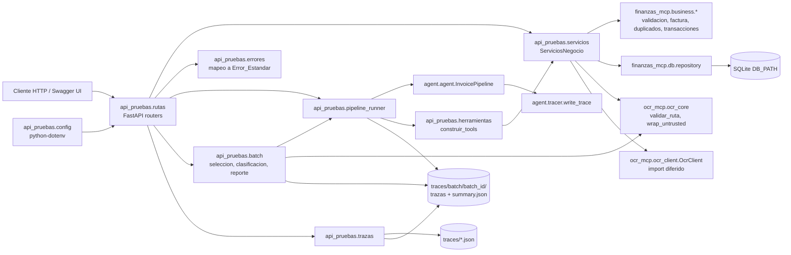
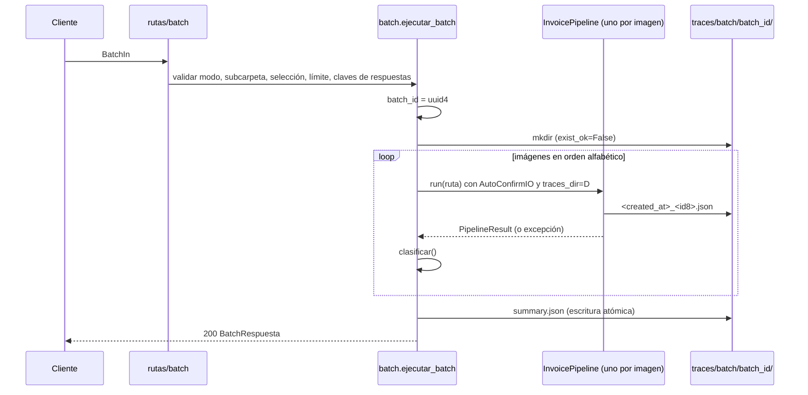

# Documento de Diseño

## Overview

La API_Pruebas es una capa HTTP delgada (FastAPI sobre uvicorn) que vive en un paquete nuevo `Backend/api_pruebas/`. No contiene reglas de negocio: llama directamente a las funciones puras que ya usan los servidores MCP y la CLI, en el mismo proceso, sin sesiones MCP stdio.

Endpoints expuestos: `POST /ocr`, `POST /validar`, `GET /transacciones`, `POST /pipeline/run`, `POST /batch/run`, `GET /batch`, `GET /batch/{batch_id}`, `GET /trazas`, `GET /trazas/{trace_id}`, `POST /test/reset` y `POST /test/seed`, más `/docs` y `/openapi.json`. La búsqueda de duplicados y el registro de transacciones no tienen endpoint HTTP propio: solo existen como herramientas internas que el Pipeline necesita.

Decisiones principales:

| Decisión | Razón |
|---|---|
| Llamar a `finanzas_mcp/business/*`, `TransactionRepository`, `OcrClient` y `InvoicePipeline` directamente | Los módulos de negocio ya están libres de `mcp`, stdin y stdout (lo declaran sus docstrings). Evita subprocesos y event loops. |
| La API nunca importa `mcp` | Con `mcp` 1.9.1 y pydantic 2.14.x la importación de `mcp` puede fallar (`eval_type_backport`, ver README). Además `fastapi` también depende de pydantic, y la API debe arrancar aunque `mcp` esté roto. |
| Extraer dos bloques de lógica que hoy viven dentro de módulos que sí importan `mcp` | `validar_ruta`, `wrap_untrusted` y `OcrToolError` están en `ocr_mcp/server.py`; la orquestación de `validar_factura` está en `finanzas_mcp/server.py`. La API no puede importarlos. Se mueven sin cambiar su comportamiento y los servidores los reimportan (ver "Refactor mínimo"). |
| Un repositorio SQLite por operación o por ejecución del Pipeline | `TransactionRepository` abre una conexión con `check_same_thread=False` y no tiene bloqueo. Los endpoints síncronos corren en un pool de hilos, así que no se comparte una conexión global. |
| Dos adaptadores sobre los mismos servicios: HTTP y herramientas del Pipeline | El HTTP traduce excepciones a `Error_Estandar`; el adaptador del Pipeline las traduce a `ToolError`. Ambos usan la misma tabla de códigos (requisitos 4.6 y 10.3). |
| El Batch es un orquestador sobre `ejecutar_pipeline`, no un segundo pipeline | `batch.py` reutiliza `ServiciosNegocio`, `construir_tools` y `InvoicePipeline` por imagen. Solo añade selección de imágenes, E/S con respuestas por imagen, clasificación y reporte. La clasificación es una función pura sobre el `PipelineResult` y su traza, fácil de probar con propiedades. |
| Cada imagen del Batch usa un `InvoicePipeline` nuevo con `traces_dir=traces/batch/<batch_id>` | `InvoicePipeline.run` escribe la traza en `traces_dir/<created_at>_<id8>.json` y no admite otra ruta. Pasar el directorio del Batch al constructor es la única forma de agrupar las trazas sin modificar `agent/`. |
| La auto-confirmación no confirma duplicados por defecto | Un duplicado es justo lo que el Batch debe detectar y clasificar. Confirmarlo registraría transacciones repetidas y ocultaría el caso. Se activa solo con `confirmar_duplicados=true` (ver "Módulo batch"). |
| Endpoints `def` (síncronos) | Todo el trabajo (SQLite, OCR con `invoke`, Pipeline) es bloqueante. FastAPI los ejecuta en un pool de hilos. |
| Módulo de configuración interno mínimo | Centraliza las variables de entorno (`DB_PATH`, `INVOICES_DIR`, `MCP_USER_ID`, `API_TEST_MODE`, etc.). No es un requisito funcional y no tiene endpoint. |

### Hallazgos del código existente que condicionan el diseño

- `agent/main.py` construye `tools` como `{nombre: callable(dict) -> resultado}` con `McpToolbox`. El Pipeline solo necesita ese diccionario, así que se construye otro equivalente sobre funciones locales. Ese diccionario incluye `buscar_duplicados` y `registrar_transaccion`, que el Pipeline usa en sus pasos 4 y 6.
- `InvoicePipeline.run` solo captura `StepLimitError`, `TokenLimitError`, `_Stop` y `PolicyError`. Un `ToolError` lanzado por `ocr_imagen` (ruta inválida, `OCR_FAILURE`) sale de `run` sin traza. El endpoint del Pipeline debe capturarlo y mapearlo (400 o 502).
- `_handle_validar_factura` lanza `ValidationError` cuando algo falla y solo conserva el primer `error_code`. La API necesita el resultado por regla, así que la orquestación se extrae a una función que devuelve todas las reglas.
- `listar_transacciones` no tiene un "límite por defecto" (el requisito 3.2 lo menciona). La API devuelve todas las filas del usuario que cumplen los filtros y no inventa un límite. Se documenta en el README.
- `InvoicePipeline.run` escribe la traza con `write_trace(trace, traces_dir)` como `<created_at>_<id8>.json` solo si `traces_dir` está definido, y deja el `trace_id` completo dentro del JSON. No hay parámetro para elegir el nombre ni la subcarpeta. Por eso el Batch construye un Pipeline por imagen con `traces_dir=traces/batch/<batch_id>`.
- Los prompts del Pipeline se identifican por su acción de traza: `duplicate_confirmation` (paso 4, pregunta "Posibles duplicados..."), `high_amount_confirmation` (token de monto alto) y `confirmation_token` (token para registrar). Cada `ask` queda en la traza como entrada con esa `action` y salida `respuesta` o `sin respuesta`. Cuando `validar_factura` falla, la traza tiene una entrada con `tool_called="validar_factura"` y `output_summary="error <CODIGO>"`; de ahí se extraen los códigos de reglas incumplidas.
- `_step4_duplicados` solo pregunta si `buscar_duplicados` devolvió coincidencias; si el usuario no responde `si`, el Pipeline termina con `user_rejection`. Los tokens de confirmación son "cualquier texto no vacío que no sea una negativa" (`no`, `n`, `cancelar`, `cancel`), y luego `registrar_transaccion` los valida con R7 y R8.
- `TransactionRepository` no tiene borrado. El reset requiere un método nuevo, aditivo (ver "Refactor mínimo").
- Las rutas por defecto (`./data/facturas.db`, `./facturas`) son relativas al directorio de trabajo. La API las resuelve contra `Backend/` para no depender de desde dónde se lance; es equivalente al comportamiento actual cuando se ejecuta desde `Backend/`.
- El `.env` real contiene valores entre comillas con comentarios al final. `python-dotenv` los interpreta correctamente; la API no debe volcar el contenido de `.env` en ningún mensaje.

## Architecture



Reglas de dependencia:

- `api_pruebas` importa de `finanzas_mcp.business`, `finanzas_mcp.db`, `finanzas_mcp.models`, `ocr_mcp.ocr_core`, `ocr_mcp.ocr_client` y `agent.*`.
- Nunca importa `finanzas_mcp.server`, `ocr_mcp.server` ni `mcp`. Una prueba de importación lo verifica (ver Estrategia de pruebas).
- `ocr_mcp.ocr_client` importa `langchain_core` al cargar el módulo, por eso se importa de forma diferida dentro de `obtener_extractor_ocr()`. Los endpoints que no usan OCR funcionan aunque falle esa importación.

### Refactor mínimo de código existente

Es el único cambio sobre módulos existentes y no altera reglas ni comportamiento (requisito 9.5):

1. `ocr_mcp/ocr_core.py` (nuevo, sin `mcp`). Contiene `ALLOWED_EXTENSIONS`, `OcrToolError`, `validar_ruta(ruta, invoices_dir=None, max_bytes=None)` y `wrap_untrusted`, movidos tal cual desde `ocr_mcp/server.py`. Los valores por defecto de `invoices_dir` y `max_bytes` se leen de `INVOICES_DIR` y `MAX_IMAGE_BYTES` del entorno con los mismos defaults (`./facturas`, 10 MB). `ocr_mcp/server.py` hace `from ocr_mcp.ocr_core import ...` y conserva los nombres públicos.
2. `finanzas_mcp/business/factura.py` (nuevo, sin `mcp`). Contiene `evaluar_factura(datos) -> ResultadoFactura`, que aplica R1, R2, R3, R4 y R6 en el mismo orden y con las mismas condiciones que `_handle_validar_factura`, pero conserva todas las reglas. `_handle_validar_factura` pasa a delegar en esta función y conserva su salida (`is_valid` o `ValidationError` con el primer código).
3. `TransactionRepository.eliminar_por_usuario(user_id) -> int` (método nuevo): `DELETE FROM transactions WHERE user_id = ?`, con commit. No modifica ningún método existente.

Si el refactor de los dos servidores se pospone, la API funciona igual (solo importa los módulos nuevos). La pérdida sería que `server.py` duplique temporalmente la lógica; por eso la tarea de refactor incluye una prueba de paridad sobre `evaluar_factura` y las pruebas existentes R1-R11 deben seguir pasando.

## Components and Interfaces

### Estructura del paquete

```
Backend/api_pruebas/
  __init__.py
  __main__.py          # lanzador: python -m api_pruebas
  app.py               # crear_app(config=None, ...) y `app`
  config.py            # configuración interna mínima
  errores.py           # excepciones de la API, ErrorEstandar, handlers, redactar()
  esquemas.py          # modelos pydantic de request y response (incluye BatchIn, ReporteBatch, ImagenResultado)
  servicios.py         # ServiciosNegocio (ocr, validar, listar, y duplicados/registrar internos)
  herramientas.py      # construir_tools(servicios) para el Pipeline
  pipeline_runner.py   # ScriptedIO y ejecutar_pipeline()
  batch.py             # seleccion de imagenes, AutoConfirmIO, clasificar(), ejecutar_batch(), reportes
  trazas.py            # listar_trazas(), leer_traza() sobre traces/ y traces/batch/*/
  modo_pruebas.py      # permisos de reset/seed y datos de ejemplo
  rutas/               # routers: ocr, factura, transacciones, pipeline, batch, trazas, pruebas
    batch.py           # POST /batch/run, GET /batch, GET /batch/{batch_id}
```

### Configuración interna (`config.py`)

Módulo mínimo, sin requisitos propios ni endpoint. Lee las variables del entorno con `python-dotenv` (`load_dotenv` sin `override`, primero `Backend/.env` y luego `budget-asistant/.env`), de modo que el entorno del proceso siempre prevalece. Esto también deja `OPENAI_API_KEY`, `ANTHROPIC_API_KEY` y `LLM_PROVIDER` en `os.environ`, que es donde los leen `OcrClient` y `resolve_provider`.

```python
@dataclass(frozen=True)
class Config:
    db_path: Path                    # DB_PATH, absoluta (default ./data/facturas.db)
    invoices_dir: Path               # INVOICES_DIR, absoluta (default ./facturas)
    user_id: str                     # MCP_USER_ID
    traces_dir: Path                 # TRACES_DIR o Backend/traces
    batch_traces_dir: Path           # BATCH_TRACES_DIR o <traces_dir>/batch
    batch_max_images: int            # BATCH_MAX_IMAGES (default 100)
    test_mode: bool                  # API_TEST_MODE == "true" (sin distinguir mayúsculas)
    test_db_allowlist: tuple[Path, ...]   # API_TEST_DB_ALLOWLIST
    ocr_model: str | None            # OCR_MODEL
    policy: Policy                   # agent.agent.load_policy
    policy_dict: dict                # JSON crudo para finanzas_mcp.business
    max_upload_bytes: int            # 10 MB (MAX_IMAGE_BYTES)

class ConfigError(Exception): ...

def cargar_config(env=os.environ) -> Config
```

- Las rutas por defecto se resuelven contra `Backend/`.
- Si `MCP_USER_ID` falta o está en blanco, `cargar_config` lanza `ConfigError` con el nombre de la variable; se invoca en el `lifespan` de arranque. Es una guarda interna, no un requisito funcional.
- La política se lee de `Backend/politica.json` una sola vez. Los límites StepLimit y TokenLimit del Pipeline salen de `policy` (requisito 4.5).
- `BATCH_MAX_IMAGES` vale 100 por defecto. Debe ser un entero entre 1 y 100; si no, `cargar_config` lanza `ConfigError` (el requisito 5.6 fija 100 como tope, así que la variable solo puede bajarlo).
- `BATCH_TRACES_DIR` vale por defecto `<traces_dir>/batch`. Se resuelve contra `Backend/` si es relativa. Cada Batch escribe en `<batch_traces_dir>/<batch_id>/`.
- Los valores de claves de API nunca se guardan en `Config` ni se serializan.

### Resolución del punto abierto: "ruta configurada como base de datos de pruebas" (requisito 7.5)

`modo_pruebas.py` expone una función pura:

```python
def db_es_de_pruebas(db_path: Path, allowlist: Sequence[Path]) -> bool:
    ruta = db_path.resolve()
    if allowlist:  # regla explícita: solo la lista
        return any(ruta == e.resolve() or e.resolve() in ruta.parents for e in allowlist)
    nombre = ruta.name.lower()   # regla por defecto: solo el nombre del archivo
    return "test" in nombre or "prueba" in nombre
```

Reglas:

1. `API_TEST_DB_ALLOWLIST` es una lista separada por `;` (o por `os.pathsep`) de archivos o carpetas. Si está definida y no vacía, es la única regla: `DB_PATH` debe ser igual a una entrada o estar dentro de una carpeta listada.
2. Si no está definida, la regla por defecto es que el nombre del archivo (no las carpetas) contenga `test` o `prueba`, sin distinguir mayúsculas. Ejemplos: `data/facturas_prueba.db` y `test.db` sí; `data/facturas.db` no.
3. Las rutas se resuelven con `Path.resolve()` antes de comparar, así que enlaces simbólicos y `..` no permiten saltarse la regla.
4. Orden de comprobación en `POST /test/reset` y `POST /test/seed`: primero `Modo_Pruebas` (403 `TEST_MODE_DISABLED`), luego la base (403 `TEST_DB_NOT_ALLOWED`). Ambas comprobaciones ocurren antes de abrir la base.
5. `API_TEST_MODE` solo se activa con el texto `true` (sin distinguir mayúsculas). `1` y `yes` no lo activan.

Consecuencia práctica: el `.env` actual usa `./data/facturas.db`, así que reset y seed responden 403 hasta que se use una base como `./data/facturas_prueba.db` o se agregue la ruta en la lista. Esto es intencional y se documenta en el README.

### ServiciosNegocio (`servicios.py`)

Recibe `Config` y un `extractor_ocr` opcional (inyectable en pruebas). Ningún método acepta `user_id`: siempre usa `config.user_id`.

```python
class ServiciosNegocio:
    def validar(self, datos: dict) -> ResultadoFactura                      # factura.evaluar_factura
    def listar(self, filtros: dict) -> list[Transaction]                    # transacciones.listar_transacciones
    def ocr_ruta(self, ruta: str) -> OcrResult                              # validar_ruta + extractor
    def ocr_subida(self, nombre: str, contenido: bytes) -> tuple[Path, OcrResult]
    def reset(self) -> int ; def seed(self, items) -> int
    # Internos, solo para el adaptador de herramientas del Pipeline (sin endpoint HTTP):
    def duplicados(self, comercio, fecha, total) -> list[Transaction]       # duplicados.buscar_duplicados
    def registrar(self, datos, token, high_token) -> int                    # transacciones.registrar_transaccion
```

- Cada método abre `with TransactionRepository(str(config.db_path)) as repo` y lo cierra al terminar.
- `listar` pasa `config.policy_dict["allowed_filters"]` y `max_date_range_days`. Un `ValidationError` de formato de fecha en filtros se trata como 400 (`INVALID_DATE_FORMAT`) en este endpoint, porque es un error de entrada del query string.
- `registrar` quita `confirmation_token`, `high_amount_token` y `user_id` de `datos` antes de llamar a `registrar_transaccion`, igual que el servidor MCP, y pasa `config.policy_dict`. Solo lo invoca el adaptador del Pipeline.
- `ocr_ruta` llama a `ocr_core.validar_ruta(ruta, str(config.invoices_dir), config.max_upload_bytes)` antes de cualquier lectura y luego a `extractor_ocr(str(resuelta))`. La respuesta usa `wrap_untrusted(result)` y se parsea a un modelo con `is_untrusted=True` forzado.
- `ocr_subida` valida en este orden, sin escribir nada hasta superar todo: extensión permitida (415), firma de bytes coherente con la extensión (JPEG `FFD8FF`, PNG `89504E47`, PDF `%PDF`; si no, 415), tamaño `<= max_upload_bytes` (413). Después guarda como `<uuid4>.<ext>` en `invoices_dir` (el nombre del cliente se descarta) y llama a `ocr_ruta`. La lectura del upload se limita a `max+1` bytes para no cargar archivos enormes.
- `obtener_extractor_ocr()` crea `OcrClient(model=config.ocr_model)` bajo un `threading.Lock` la primera vez y lo reutiliza. Cualquier excepción del extractor se convierte en `OcrToolError("OCR_FAILURE", ...)` con solo el nombre del tipo de excepción (igual que el servidor MCP) y mensaje redactado.

### Endpoints

| Método y ruta | Request | Respuesta exitosa | Errores |
|---|---|---|---|
| `POST /ocr` | `multipart/form-data`: `ruta` (texto) o `archivo` (archivo); exactamente uno | 200 `OcrRespuesta` | 400, 413, 415, 422, 502 |
| `POST /validar` | JSON `FacturaIn` | 200 `ValidacionRespuesta` | 422 |
| `GET /transacciones` | query: `comercio`, `fecha_desde`, `fecha_hasta`, `categoria`, `moneda` | 200 `list[TransaccionOut]` | 400 |
| `POST /pipeline/run` | JSON `PipelineIn` | 200 `PipelineRespuesta` | 400, 422, 502 |
| `POST /batch/run` | JSON `BatchIn` | 200 `BatchRespuesta` (`batch_id` y `reporte`) | 400, 403, 404, 422 |
| `GET /batch` | | 200 `list[BatchResumen]` | |
| `GET /batch/{batch_id}` | | 200 `ReporteBatch` | 400, 404 |
| `GET /trazas` | | 200 `list[TrazaResumen]` (incluye trazas de Batches) | |
| `GET /trazas/{trace_id}` | | 200 `dict` redactado (también para trazas de Batches) | 400, 404 |
| `POST /test/reset` | | 200 `ResetRespuesta` | 403 |
| `POST /test/seed` | JSON `SeedIn` opcional | 200 `SeedRespuesta` | 403, 422 |

Notas:

- `POST /ocr` usa un único formulario multipart porque FastAPI no combina JSON y archivo en una misma operación de forma limpia. Con `curl`: `-F ruta=batch1-0001.jpg` o `-F archivo=@factura.jpg`.
- `GET /transacciones` declara los cinco filtros para que aparezcan en Swagger, pero reenvía a `listar` todas las claves de `request.query_params`. Así un parámetro desconocido llega a `FilterError` y produce 400 en lugar de ser ignorado por FastAPI.
- Los endpoints de la tabla son `def`, con `response_model` y `responses={...}` para documentar los códigos de error.

### Modelos de request (`esquemas.py`)

Todos heredan de `ModeloEstricto` (`extra="forbid"`, `allow_inf_nan=False`). Un campo desconocido, incluido `user_id`, produce 422 (requisito 2.4).

```python
class FacturaIn(ModeloEstricto):
    comercio: str | None = None; fecha: str | None = None
    total: StrictFloat | StrictInt | None = None; moneda: str | None = None
    categoria: str | None = None; subtotal: ... = None; iva: ... = None; descripcion: str | None = None
```

- En `FacturaIn` los campos obligatorios son opcionales a nivel de esquema para que `/validar` devuelva el código de la regla (`MISSING_FIELDS`) en lugar de un error genérico de pydantic. Los tipos incorrectos (por ejemplo `total` como texto) sí dan 422.
- `PipelineIn`: `ruta: str`, `respuestas: list[str] = []`.
- `BatchIn`: `subcarpeta: str` (nombre o ruta relativa dentro de `INVOICES_DIR`, por ejemplo `test_batch_1`), `respuestas_por_defecto: list[str] = []`, `respuestas_por_imagen: dict[str, list[str]] = {}` (clave: nombre de archivo de la subcarpeta), `auto_confirmar: bool = False`, `confirmar_duplicados: bool = False`. `confirmar_duplicados` solo tiene efecto con `auto_confirmar=true`. Máximo 100 claves en `respuestas_por_imagen` y 50 respuestas por lista (límite de tamaño de request; 422 si se supera).
- `SeedIn`: `transacciones: list[SeedItem] | None`; `SeedItem` son los campos de factura obligatorios más opcionales, sin `user_id`.

### Modelos de response

```python
class ErrorEstandar(BaseModel): code: str; message: str
class ReglaResultado(BaseModel): regla: str; valid: bool; code: str | None; message: str | None
class ValidacionRespuesta(BaseModel): valid: bool; reglas: list[ReglaResultado]
class OcrRespuesta(BaseModel): untrusted_content: Literal[True]; is_untrusted: Literal[True]; notice: str; result: dict; ruta: str
class TransaccionOut(BaseModel): id, user_id, comercio, fecha, total, moneda, categoria, subtotal, iva, descripcion, created_at
class PipelineRespuesta(BaseModel):
    status: str; termination_reason: str; transaction_id: int | None
    trace_id: str; mensajes: list[str]; prompts: list[str]
class TrazaResumen(BaseModel): trace_id: str; created_at: str; status: str
Clasificacion = Literal["ok", "duplicada", "no_valida", "step_limit", "token_limit", "user_rejection", "error"]
class ImagenResultado(BaseModel):
    archivo: str; clasificacion: Clasificacion; motivo: str       # motivo: código estable, p. ej. "DUPLICATE_DB"
    detalle: str | None            # texto corto sin pila ni claves
    status: str | None             # status del Pipeline; None si hubo excepción
    termination_reason: str | None
    trace_id: str | None           # None si la excepción salió antes de escribir traza
    transaction_id: int | None
    reglas_incumplidas: list[str] = []      # solo en no_valida
    duplicada_de: str | None = None         # nombre de la imagen coincidente, si existe
class ConteoClasificaciones(BaseModel): ok: int; duplicada: int; no_valida: int; step_limit: int; token_limit: int; user_rejection: int; error: int
class ReporteBatch(BaseModel):
    batch_id: str; subcarpeta: str; fecha: str      # ISO 8601 UTC
    total: int; conteos: ConteoClasificaciones; imagenes: list[ImagenResultado]
class BatchResumen(BaseModel): batch_id: str; fecha: str; total: int; conteos: ConteoClasificaciones
class BatchRespuesta(BaseModel): batch_id: str; reporte: ReporteBatch
class ResetRespuesta(BaseModel): eliminadas: int
class SeedRespuesta(BaseModel): insertadas: int
```

- `PipelineRespuesta.prompts` lista las preguntas que hizo el Pipeline, para que quien escribe `respuestas` vea el orden esperado. Pueden contener valores derivados del OCR (acotados por el Pipeline a 200 caracteres sin controles); son datos inertes en JSON.
- Ningún modelo expone variables de entorno ni valores de claves de API.

### Mapeo uniforme de errores (`errores.py`)

Una tabla única convierte excepciones en `(http_status, code, message)`. La usan los handlers HTTP y el adaptador del Pipeline.

| Origen | HTTP | `code` |
|---|---|---|
| `ValidationError` (reglas R1-R8, lanzado por herramientas del Pipeline) | 422 | `result.error_code` |
| `ValidationError` (fecha inválida en filtros del listado) | 400 | `INVALID_DATE_FORMAT` |
| `FilterError` | 400 | `INVALID_FILTER` |
| `DateRangeError` | 400 | `DATE_RANGE_EXCEEDED` |
| `OcrToolError` con `PATH_VIOLATION` o `INVALID_IMAGE` | 400 | el mismo código |
| `OcrToolError` con `OCR_FAILURE` | 502 | `OCR_FAILURE` |
| `ToolError` del Pipeline | 400 si el código es `PATH_VIOLATION` o `INVALID_IMAGE`; 502 si es `OCR_FAILURE`; 422 en otro caso | `err.code` |
| Subida demasiado grande / tipo no soportado | 413 / 415 | `FILE_TOO_LARGE` / `UNSUPPORTED_MEDIA` |
| Traza: id mal formado / inexistente | 400 / 404 | `INVALID_TRACE_ID` / `TRACE_NOT_FOUND` |
| Modo pruebas deshabilitado / base no permitida | 403 | `TEST_MODE_DISABLED` / `TEST_DB_NOT_ALLOWED` |
| Batch: subcarpeta absoluta, con traversal, symlink o fuera de `INVOICES_DIR` | 400 | `BATCH_PATH_VIOLATION` |
| Batch: subcarpeta inexistente o no es directorio | 404 | `BATCH_FOLDER_NOT_FOUND` |
| Batch: sin imágenes con extensión permitida | 400 | `BATCH_NO_IMAGES` |
| Batch: más de `BATCH_MAX_IMAGES` imágenes permitidas | 400 | `BATCH_TOO_MANY_IMAGES` |
| Batch: `respuestas_por_imagen` con nombres que no están en la selección | 400 | `BATCH_UNKNOWN_IMAGE` |
| Batch: `auto_confirmar=true` con Modo_Pruebas deshabilitado | 403 | `TEST_MODE_DISABLED` |
| Batch: `batch_id` mal formado / inexistente o de otro usuario | 400 / 404 | `INVALID_BATCH_ID` / `BATCH_NOT_FOUND` |
| Batch: fallo interno de una imagen (no es una respuesta HTTP) | 200 | clasificación `error`, motivo `BATCH_IMAGE_ERROR` o el código de la herramienta |
| Batch: no se pudo crear el directorio de salida o escribir `summary.json` | 500 | `INTERNAL_ERROR` |
| `RequestValidationError` de FastAPI | 422 | `VALIDATION_ERROR` (mensaje con `loc` y `msg`, sin eco del valor recibido) |
| Cualquier otra `Exception` | 500 | `INTERNAL_ERROR`, mensaje fijo |

- El código de regla nunca se altera (requisito 10.3). El mensaje pasa por `redactar()`.
- El handler de 500 registra solo el tipo de la excepción y un mensaje redactado, y el cuerpo es siempre `{"code":"INTERNAL_ERROR","message":"Error interno del servidor."}` sin pila (requisito 10.2).
- `redactar(obj)` recorre recursivamente cadenas, listas y diccionarios. Sustituye por `***` cada valor de variables que terminan en `_API_KEY` (si tienen 8 caracteres o más) y todo texto con el patrón de claves conocidas (`sk-[A-Za-z0-9_-]{16,}`, que cubre también `sk-ant-...`). Se aplica a mensajes de error, a trazas devueltas y a respuestas del Pipeline. Un `logging.Filter` aplica `redactar` a los registros del logger `api_pruebas`.

### Adaptador de herramientas del Pipeline (`herramientas.py`)

`construir_tools(servicios) -> dict[str, Callable[[dict], Any]]` reproduce el contrato de `McpToolbox.tools` con las mismas cinco claves de `TOOL_SERVERS`. Las herramientas `buscar_duplicados` y `registrar_transaccion` se conservan aquí porque el Pipeline las necesita (pasos 4 y 6), aunque no tengan endpoint HTTP propio.

| Herramienta | Implementación | Retorno hacia `normalize_tool_result` |
|---|---|---|
| `ocr_imagen` | `servicios.ocr_ruta(args["ruta"])` | `wrap_untrusted(result)` como `str` JSON (el Pipeline lee `raw["result"]`) |
| `validar_factura` | `servicios.validar(args)` | `{"is_valid": True, "errors": []}`; si falla lanza `ToolError(primer_codigo, mensaje)` |
| `buscar_duplicados` | `servicios.duplicados(...)` | lista de dicts de transacción |
| `listar_transacciones` | `servicios.listar(args.get("filtros", {}))` | lista de dicts |
| `registrar_transaccion` | `servicios.registrar(...)` ignorando `user_id` del payload | `{"id": id, "status": "registrada"}` |

- Las excepciones de negocio (`ValidationError`, `FilterError`, `DateRangeError`, `OcrToolError`) se convierten en `ToolError(code, message)` con el mismo código, que es lo que haría `normalize_tool_result` con un `isError` MCP. Así el Pipeline se comporta igual que con MCP.
- El Pipeline sigue aplicando su `Policy`: `registrar_transaccion` requiere confirmación y las demás herramientas están permitidas según `politica.json`.
- El `user_id` de los servicios es siempre `config.user_id`; el Pipeline ni siquiera lo envía (comentario en `_step4_duplicados`).
- Las herramientas usan las mismas funciones de negocio y los mismos métodos de `ServiciosNegocio` que los endpoints de los requisitos 1 a 3 (requisito 4.6).

### Ejecución del Pipeline (`pipeline_runner.py`)

```python
class ScriptedIO:               # implementa el Protocol UserIO
    def __init__(self, respuestas: Sequence[str]): ...
    def ask(self, prompt) -> str | None   # devuelve la siguiente respuesta; None al agotarse
    def notify(self, message) -> None     # acumula en self.mensajes
    prompts: list[str]; mensajes: list[str]

def ejecutar_pipeline(servicios, config, ruta, respuestas) -> PipelineRespuesta
```

Flujo de `POST /pipeline/run`:

1. Se valida la ruta con `ocr_core.validar_ruta` antes de crear el Pipeline. Si falla, 400 sin ejecutar (requisito 4.4). El Pipeline recibe la ruta original; la herramienta `ocr_imagen` vuelve a validarla.
2. Se crea, por solicitud, un `ScriptedIO`, un diccionario de herramientas y un `InvoicePipeline(tools, io, config.policy, config.user_id, str(config.traces_dir))`. Los contadores `StepCounter` y `TokenCounter` y el `Trace` son atributos de la instancia, así que dos ejecuciones concurrentes no comparten estado (requisito 4.8). Cada ejecución tiene su propio `trace_id` (UUID4).
3. Se llama a `pipeline.run(ruta)` y se arma `PipelineRespuesta` con `result.status`, `result.termination_reason`, `result.transaction_id`, `result.trace.trace_id`, `io.mensajes` e `io.prompts`.
4. Si `run` deja salir un `ToolError` (ver Hallazgos), se mapea con la tabla de errores y se responde 400 o 502.
5. Cualquier `status` del Pipeline (`success`, `validation_error`, `user_abort`, `step_limit`, `token_limit`) responde 200.

### Módulo batch (`batch.py`, `rutas/batch.py`)

#### Flujo de `POST /batch/run`



Orden de validaciones (todas antes de crear el directorio de salida o ejecutar el Pipeline):

1. `auto_confirmar=true` con `Modo_Pruebas` deshabilitado: 403 `TEST_MODE_DISABLED`.
2. Confinamiento de la subcarpeta (400 `BATCH_PATH_VIOLATION`).
3. Existencia y tipo de directorio (404 `BATCH_FOLDER_NOT_FOUND`).
4. Selección de imágenes: sin imágenes (400 `BATCH_NO_IMAGES`), más del límite (400 `BATCH_TOO_MANY_IMAGES`).
5. Claves de `respuestas_por_imagen` presentes en la selección (400 `BATCH_UNKNOWN_IMAGE`).

#### Confinamiento de la subcarpeta

```python
def resolver_subcarpeta(subcarpeta: str, invoices_dir: Path) -> Path:
    # 1. rechazar: vacía, con NUL, absoluta (Path/PureWindowsPath/PurePosixPath), unidad "C:", UNC, o algún segmento ".." o "."
    # 2. base = invoices_dir.resolve()
    # 3. recorrer segmento a segmento desde base: si algún componente existente is_symlink() -> BATCH_PATH_VIOLATION
    # 4. destino = (base / rel).resolve(); exigir destino.is_relative_to(base) y destino != base
    # 5. existe y is_dir() -> devolver; si no existe -> BATCH_FOLDER_NOT_FOUND
```

- Los rechazos de forma (1) y de enlace o escape (3 y 4) ocurren antes de cualquier acceso a disco más allá del `lstat` de los componentes, y devuelven 400. La no existencia se evalúa después y devuelve 404.
- Se rechaza el enlace simbólico en cualquier componente (no solo cuando el destino final escapa), porque un symlink dentro del directorio que apunte a otro lugar de `INVOICES_DIR` seguiría siendo ambiguo para el confinamiento y el requisito pide rechazar symlinks.
- Se usa `Path.resolve()` (no `os.path.abspath`) para normalizar. En Windows también se rechazan nombres reservados y rutas con `:` en cualquier segmento.
- La subcarpeta debe ser distinta de `INVOICES_DIR` (el Batch trabaja sobre subcarpetas).

#### Selección y orden de imágenes

```python
def seleccionar_imagenes(carpeta: Path, max_images: int) -> list[Path]:
    # solo hijos directos (sin recursión), archivos regulares, no symlink,
    # extension.lower() in ocr_core.ALLOWED_EXTENSIONS,
    # orden: sorted(key=lambda p: (p.name.casefold(), p.name))
```

- Los symlinks, subdirectorios y archivos con otras extensiones se ignoran y no cuentan para el total ni para el límite. Los archivos ocultos se tratan igual que los demás.
- El conteo para el límite se hace antes de ejecutar nada: `len(seleccion) > max_images` produce 400 sin ejecutar el Pipeline.
- Cada imagen seleccionada pasa de todos modos por `validar_ruta(ruta, invoices_dir)`, que se invoca dentro del Pipeline mediante la herramienta `ocr_imagen`. Se pasa la ruta relativa a `INVOICES_DIR` (`<subcarpeta>/<archivo>`) para que `validar_ruta` la resuelva igual que en `POST /pipeline/run`.
- El mismo `sorted` con la misma clave hace que dos ejecuciones sobre la misma carpeta procesen en el mismo orden (determinista, sin depender del orden del sistema de archivos).

#### Respuestas por imagen y auto-confirmación (`AutoConfirmIO`)

`AutoConfirmIO` implementa `UserIO` y envuelve a `ScriptedIO`. Se construye por imagen con las respuestas asignadas: `respuestas_por_imagen[archivo]` si existe (aunque sea lista vacía) o, si no, `respuestas_por_defecto`.

Para cada `ask(prompt)`:

1. Si todavía quedan respuestas en el guion de la imagen, devuelve la siguiente (misma semántica que `ScriptedIO`; propiedad 8).
2. Si el guion se agotó y `auto_confirmar` es falso, devuelve `None` ("sin respuesta").
3. Si el guion se agotó y `auto_confirmar` es verdadero (solo posible con Modo_Pruebas habilitado), clasifica el prompt y responde:

| Prompt del Pipeline | Cómo se reconoce | Respuesta auto |
|---|---|---|
| Token para registrar (`confirmation_token`) | el prompt contiene `token de confirmación para registrar` | `TEST-CONFIRM` |
| Token de monto alto (`high_amount_confirmation`) | el prompt contiene `token de confirmación de monto alto` | `TEST-HIGH-AMOUNT` |
| Duplicados (`duplicate_confirmation`) | el prompt empieza con `Posibles duplicados` | `si` si `confirmar_duplicados=true`; `None` si no |
| Cualquier otro (campos faltantes, categoría, aritmética, moneda, fecha) | resto | `None` |

- Decisión: por defecto la auto-confirmación no confirma duplicados. Si una imagen es duplicada, el Pipeline recibe "sin respuesta", termina con `user_rejection` y la imagen se clasifica `duplicada`. Con `confirmar_duplicados=true` el Pipeline registra el duplicado y la imagen se clasifica `ok` con `detalle` que indica `duplicado confirmado` (ver clasificación).
- Los tokens `TEST-CONFIRM` y `TEST-HIGH-AMOUNT` son constantes de `batch.py` y pasan R7 y R8 porque son texto no vacío distinto de una negativa. Solo existen dentro de `AutoConfirmIO`; ningún endpoint los acepta ni los devuelve como configuración, y no hay forma de que el cliente los inyecte cuando Modo_Pruebas está apagado: el 403 ocurre antes de crear el `AutoConfirmIO`.
- Los prompts se reconocen por texto porque `agent.py` no expone constantes. Se acepta el acoplamiento y se protege con una prueba de contrato que ejecuta el Pipeline real con un OCR simulado y comprueba que los tres prompts disparan las respuestas esperadas. Si en el futuro se agregan constantes de prompt a `agent.py`, `batch.py` debería importarlas.
- Las respuestas provistas explícitamente tienen prioridad: el cliente puede contestar `no` a un duplicado o dar otro token y la auto-confirmación no lo reemplaza.
- `AutoConfirmIO` acumula `mensajes` y `prompts` como `ScriptedIO`; los mensajes no se incluyen en el reporte (solo `motivo` y `detalle`) para no arrastrar contenido derivado del OCR al resumen.

#### Clasificación

`clasificar(resultado, trazas_entries, datos, vistos) -> ImagenResultado` es una función pura. Entradas: el `PipelineResult` (o la excepción capturada), las entradas de la traza, los datos extraídos (`result.datos`) y el diccionario `vistos` de claves normalizadas de imágenes anteriores del mismo Batch.

Reglas, evaluadas en este orden (la primera que aplica gana, por eso la clasificación es única):

| # | Condición | Clasificación | `motivo` |
|---|---|---|---|
| 1 | La ejecución lanzó una excepción que no es `ToolError` ni `OcrToolError` | `error` | `BATCH_IMAGE_ERROR` (solo el nombre del tipo, sin pila ni mensaje) |
| 2 | La ejecución lanzó `ToolError`/`OcrToolError` con `PATH_VIOLATION` o `INVALID_IMAGE` | `no_valida` | el código |
| 3 | La ejecución lanzó `ToolError`/`OcrToolError` con `OCR_FAILURE` u otro código | `error` | el código |
| 4 | `status == "success"` | `ok` | `REGISTERED` (si hubo `duplicate_confirmation` con respuesta, `detalle="duplicado confirmado"`) |
| 5 | `termination_reason == "step_limit"` | `step_limit` | `STEP_LIMIT` |
| 6 | `termination_reason == "token_limit"` | `token_limit` | `TOKEN_LIMIT` |
| 7 | Hay una entrada de traza con `action == "duplicate_confirmation"` (el paso 4 encontró coincidencias en la base), o la clave `(comercio normalizado, fecha, total)` de `datos` ya está en `vistos` | `duplicada` | `DUPLICATE_DB` o `DUPLICATE_IN_BATCH`; `duplicada_de` = imagen coincidente si se conoce |
| 8 | `termination_reason == "validation_failure"` | `no_valida` | `VALIDATION_FAILURE`; `reglas_incumplidas` = códigos `error <CODIGO>` de entradas con `tool_called == "validar_factura"` (únicos y en orden) |
| 9 | `termination_reason == "user_rejection"` | `user_rejection` | `USER_REJECTION` |
| 10 | Cualquier otro caso | `error` | `UNKNOWN_TERMINATION` |

Aclaraciones:

- Los límites tienen prioridad sobre la duplicada (reglas 5 y 6 antes que 7) porque indican que el Pipeline no completó su revisión. Una imagen con duplicado y `step_limit` queda `step_limit`.
- La regla 7 se evalúa solo cuando `status != "success"`. Una imagen exitosa tras confirmar un duplicado explícitamente es `ok` (regla 4), porque el requisito 5.14 manda `ok` ante `success`.
- Las reglas 1 a 3 solo aplican cuando `run` lanzó una excepción (no hay `PipelineResult`); se implementan en una función `clasificar_excepcion(exc)`. Las reglas 4 a 10 se implementan en `clasificar(resultado, vistos)` y solo aplican cuando hay `PipelineResult`. La excepción por ruta o imagen inválida (regla 2) se clasifica `no_valida` por el requisito 5.16 (fallo de OCR, ruta o confianza); un fallo del proveedor OCR (regla 3) es `error`.
- Duplicada entre imágenes del Batch: la clave es `(comercio.strip().casefold(), fecha, round(float(total), 2))` y se calcula solo si `datos` tiene los tres campos. Se registra en `vistos` después de clasificar toda imagen que tenga los tres campos, con el nombre del archivo. La coincidencia se anota con `duplicada_de`. Esto cubre el caso en que la primera imagen no se registró (por ejemplo, terminó en `user_rejection`) y por eso el paso 4 no ve el duplicado en la base.
- `DUPLICATE_DB` no tiene `duplicada_de` (la coincidencia está en la base, no en el Batch) salvo que además haya coincidencia en `vistos`, en cuyo caso se informa la imagen del Batch.
- `reglas_incumplidas` solo se llena en `no_valida`. Si el fallo no vino de `validar_factura` (por ejemplo, el usuario no aclaró un campo), la lista queda vacía y el `motivo` sigue siendo `VALIDATION_FAILURE`.
- Los detalles nunca incluyen mensajes del OCR ni pilas. `detalle` es una cadena corta fija por regla, o el nombre del tipo de excepción.

#### Ejecución por imagen

```python
def ejecutar_batch(servicios, config, req: BatchIn) -> BatchRespuesta:
    ...
    batch_id = str(uuid.uuid4())
    salida = config.batch_traces_dir / batch_id          # mkdir(parents=True, exist_ok=False)
    vistos: dict[tuple, str] = {}
    for imagen in seleccion:
        io = AutoConfirmIO(guion_de(imagen), auto, confirmar_duplicados)
        pipeline = InvoicePipeline(construir_tools(servicios), io, config.policy, config.user_id, str(salida))
        try:
            resultado = pipeline.run(ruta_relativa(imagen))
            fila = clasificar(resultado, vistos)
        except Exception as exc:                       # incluye ToolError que sale de run()
            fila = clasificar_excepcion(imagen.name, exc)
        resultados.append(fila)
    guardar_reporte_atomico(salida, reporte)
```

- Las imágenes se procesan una a una dentro de un Batch (no hay paralelismo interno), así `vistos` no necesita bloqueo y el orden de resultados coincide con el orden de selección.
- Cada imagen usa su propio `InvoicePipeline` (contadores, traza y tokens independientes) y su propio `AutoConfirmIO`. Un `StepLimitError` de una imagen no afecta a la siguiente.
- Una excepción en una imagen se captura con `except Exception`, se clasifica `error` sin pila ni mensaje y el bucle continúa. `KeyboardInterrupt` y `SystemExit` no se capturan.
- Si la excepción salió de `run` antes de escribir la traza, `trace_id` queda `null` en esa fila.
- El `trace_id` de cada fila sale de `resultado.trace.trace_id`; el archivo existe en el directorio del Batch salvo que `write_trace` haya fallado (limitación conocida).

#### Reporte, escritura atómica y propietario

- `summary.json` contiene los campos de `ReporteBatch` más `user_id` (propietario). El campo `user_id` se guarda en el archivo para el control de acceso, pero el modelo de respuesta `ReporteBatch` no lo expone.
- Escritura atómica: se escribe `summary.json.tmp-<uuid4>` en el mismo directorio, se hace `flush` + `os.fsync` y se renombra con `os.replace` a `summary.json`. Un lector nunca ve un `summary.json` parcial. Si falla, se borra el temporal y se responde 500 `INTERNAL_ERROR`.
- `summary.json` se escribe una sola vez, al terminar todas las imágenes. Un Batch en curso (o que murió) tiene directorio pero no `summary.json`; `GET /batch` y `GET /batch/{id}` lo tratan como inexistente.
- `batch_id` es `uuid4` generado por el servidor; el cliente no lo puede elegir. El directorio se crea con `exist_ok=False`, así que una colisión (prácticamente imposible) falla en vez de mezclar Batches.

#### Consulta de reportes

- `GET /batch`: recorre los hijos directos de `batch_traces_dir` cuyo nombre cumple `^[A-Za-z0-9-]{1,64}$` y que no son symlinks, lee `summary.json` si existe, descarta los ilegibles y los de otro `user_id`, y devuelve `BatchResumen` ordenados por `fecha` descendente.
- `GET /batch/{batch_id}`: valida el id con `^[A-Za-z0-9-]{1,64}$` antes de tocar el sistema de archivos (400 `INVALID_BATCH_ID`). Luego lista el directorio y compara el nombre, sin concatenar el id en una ruta hasta confirmar que está en la lista. Si no existe, no tiene `summary.json` o pertenece a otro usuario: 404 `BATCH_NOT_FOUND` con el mismo mensaje en los tres casos. La respuesta pasa por `redactar()`.

#### Aislamiento y concurrencia

- Dos Batches concurrentes (incluso sobre la misma subcarpeta) obtienen `batch_id` distintos y directorios distintos. No comparten `AutoConfirmIO`, `vistos`, `StepCounter`, `TokenCounter`, ni `Trace`.
- Lo único compartido es la base SQLite y el directorio de imágenes, en modo lectura. Las transacciones que registre cada Batch quedan en la base y las ve el otro Batch en el paso 4. Eso puede hacer que dos Batches simultáneos sobre las mismas imágenes cambien su resultado (el segundo ve el duplicado del primero). Es una consecuencia esperada del estado compartido y no una violación del aislamiento de reportes; se documenta en el README.
- Los endpoints son `def`, así que un Batch largo ocupa un hilo del pool de FastAPI, no el event loop. El tiempo total de un Batch está acotado por 100 imágenes por los límites de pasos y tokens de cada Pipeline. No se implementan jobs asíncronos ni cancelación (fuera de alcance).
- Redacción: `ReporteBatch`, `summary.json` y las respuestas pasan por `redactar()` antes de escribirse y de devolverse.

### Trazas (`trazas.py`)

- `write_trace` escribe `{created_at}_{trace_id[:8]}.json` con el `trace_id` dentro del JSON. No existe un índice, así que las consultas recorren el directorio.
- Raíces de búsqueda: `traces_dir` (archivos `*.json` directos) y cada directorio hijo `batch_traces_dir/<batch_id>/` (solo `*.json`, excluyendo `summary.json`). El segundo nivel se acota así: el nombre del directorio cumple `^[A-Za-z0-9-]{1,64}$`, el hijo no es un symlink, su `resolve()` está dentro de `batch_traces_dir.resolve()` y se lista solo un nivel (sin recursión). Los archivos que sean symlinks se ignoran.
- `listar_trazas(traces_dir, batch_traces_dir, user_id)`: lee cada `*.json` de las raíces, ignora archivos ilegibles, `summary.json` y los que no tienen `trace_id`, conserva solo los que tienen `user_id == config.user_id` y devuelve `trace_id`, `created_at` y `final_status` (como `status`), ordenados por `created_at` descendente.
- `leer_traza(traces_dir, batch_traces_dir, user_id, trace_id)`:
  1. Valida `trace_id` con `^[A-Za-z0-9-]{1,64}$`. Si no cumple lanza `INVALID_TRACE_ID` (400) antes de tocar el sistema de archivos.
  2. Filtra por nombre `*_{trace_id[:8]}.json` en las raíces listadas y confirma que el JSON contiene `trace_id` igual y `user_id` igual a la sesión.
  3. Si no hay coincidencia (no existe o es de otro usuario), lanza `TRACE_NOT_FOUND` (404) con el mismo mensaje en ambos casos.
  4. Devuelve el contenido pasado por `redactar()`.
- Ninguna ruta del sistema de archivos se construye con el `trace_id` recibido, solo se compara contra nombres listados.

### Lanzador y red (`__main__.py`, `app.py`)

- `python -m api_pruebas [--host 127.0.0.1] [--port 8000]` llama a `uvicorn.run("api_pruebas.app:app", host=..., port=...)`. El host por defecto es `127.0.0.1` y se puede cambiar con `API_HOST` o `--host`.
- `host_es_local(host) -> bool` es verdadero solo para `127.0.0.1` y `localhost`. Si es falso, el lanzador y el `lifespan` registran una advertencia de exposición en red. En el `lifespan` se detecta el host de forma best-effort leyendo `--host` en `sys.argv` o `API_HOST`, porque uvicorn no lo pasa a la aplicación.
- También se puede iniciar con `uvicorn api_pruebas.app:app`. Ambas formas se documentan en el README.
- `requirements.txt` agrega `fastapi`, `uvicorn` y `python-multipart` con `==`. Las versiones exactas se fijan al implementar, probando la instalación en el venv: el entorno actual tiene `uvicorn 0.54.0`, `python-multipart 0.0.33`, `starlette 1.10.0` y `pydantic 2.14.3`, pero `fastapi` no está instalado y su compatibilidad con ese `starlette` no se pudo verificar en esta fase. `httpx 0.28.1` (ya instalado) permite usar `fastapi.testclient.TestClient`.

## Data Models

No hay tablas nuevas. Se reutiliza `transactions` (`schema.sql`), con `finanzas_mcp.models.Transaction`.

- `Config` (arriba) es el único estado global de la aplicación, guardado en `app.state.config` junto con `app.state.servicios`.
- Estructura en disco del Batch: `traces/batch/<batch_id>/` contiene un `<created_at>_<id8>.json` por imagen procesada (formato de `Trace`) y, al final, `summary.json`:

```json
{
  "batch_id": "uuid4", "user_id": "<Usuario_Sesion>", "subcarpeta": "test_batch_1",
  "fecha": "2025-01-01T12:00:00+00:00", "total": 3,
  "conteos": {"ok": 1, "duplicada": 1, "no_valida": 1, "step_limit": 0, "token_limit": 0, "user_rejection": 0, "error": 0},
  "imagenes": [{"archivo": "a.jpg", "clasificacion": "ok", "motivo": "REGISTERED", "detalle": null,
                "status": "success", "termination_reason": "success", "trace_id": "uuid4",
                "transaction_id": 7, "reglas_incumplidas": [], "duplicada_de": null}]
}
```

- Estructura de traza en disco: `agent.tracer.Trace` serializada con `asdict` (campos `trace_id`, `user_id`, `image_path`, `entries`, `final_status`, `termination_reason`, `created_at`, `transaction_id`).
- Conjunto de ejemplo para `POST /test/seed` sin cuerpo (en `modo_pruebas.py`): 5 transacciones con fechas pasadas fijas, mezcla de CRC y USD, categorías de `CLOSED_CATEGORY_LIST`, todas válidas según `evaluar_factura` (una prueba lo verifica).
- Normalización que aplica `registrar_transaccion` (usada por el Pipeline y por el seed): `moneda` se guarda en mayúsculas y sin espacios, `categoria` sin espacios en los extremos, `total` como `float`.

## Correctness Properties

*Una propiedad es una característica o comportamiento que debe cumplirse en todas las ejecuciones válidas de un sistema; es decir, un enunciado formal de lo que el sistema debe hacer. Las propiedades son el puente entre las especificaciones legibles por personas y las garantías de corrección verificables por máquina.*

Reflexión sobre redundancias: la redacción de secretos (1.6, 5.24, 6.5, 10.2) se fusionó en una propiedad; los criterios 2.1, 2.2, 2.3 y 2.5 se fusionaron en la coherencia con las reglas; 3.1 a 3.5 se fusionaron en una propiedad de listado; 4.2, 4.5, 4.6 y 4.7 se fusionaron en la propiedad del Pipeline. Del requisito 5: 5.13 a 5.17 y 5.19 se fusionaron en la clasificación; 5.1, 5.11, 5.12 y 5.18 en el reporte; 5.7 a 5.10 en la auto-confirmación; 5.20 a 5.25 en la consulta de reportes. Los criterios 5.3 y 5.4 se cubren con los generadores de confinamiento y selección. 7.1 y 7.5 comparten el predicado de permiso; 7.2, 7.3 y 7.6 comparten el aislamiento por usuario.

### Property 1: Redacción de secretos

*Para toda* estructura JSON anidada y todo conjunto de valores secretos de al menos 8 caracteres incrustados en cadenas de la estructura, la serialización de `redactar(estructura)` no contiene ninguno de los secretos, y las cadenas que no contenían secretos quedan idénticas.

**Validates: Requirements 1.6, 5.24, 6.5, 10.2**

### Property 2: Confinamiento de rutas

*Para toda* cadena de ruta (con segmentos `..`, rutas absolutas, separadores mixtos, caracteres nulos y extensiones variadas), `validar_ruta` termina con éxito solo si el resultado resuelto está dentro de `INVOICES_DIR`, tiene una extensión permitida y es un archivo existente; en cualquier otro caso lanza `OcrToolError` y la API responde 400 sin leer el archivo ni ejecutar el Pipeline.

**Validates: Requirements 1.1, 1.3, 4.4**

### Property 3: Subidas confinadas y acotadas

*Para todo* nombre de archivo original (incluidos nombres con traversal o separadores), todo contenido y toda extensión: si la subida se acepta, el archivo guardado es hijo directo de `INVOICES_DIR` con nombre `<uuid4>.<ext permitida>`; si la extensión no está permitida o la firma no coincide, la respuesta es 415; si el tamaño supera el máximo, 413; y en los dos rechazos el contenido de `INVOICES_DIR` queda sin cambios.

**Validates: Requirements 1.2, 1.4**

### Property 4: El resultado OCR siempre es no confiable

*Para todo* `OcrResult` devuelto por el extractor (con cualquier texto, incluido texto con instrucciones, y con `is_untrusted` verdadero o falso), la respuesta de `POST /ocr` tiene `untrusted_content=true` e `is_untrusted=true`, y el texto aparece solo dentro de `result.text` sin alterar herramientas ni códigos de estado.

**Validates: Requirements 1.5, 1.7**

### Property 5: La validación es coherente con las reglas

*Para toda* factura generada (válida o con campos faltantes, fechas inválidas o futuras, monedas inválidas, incoherencia aritmética y categorías fuera de lista), `valid` es verdadero si y solo si cada validador de `validacion.py` aplicable acepta los datos, con código 200 en ambos casos; y cada regla fallida aparece con el código que devuelve su validador.

**Validates: Requirements 2.1, 2.2, 2.3, 2.5**

### Property 6: Campos desconocidos y `user_id` se rechazan sin efectos

*Para todo* cuerpo de request de `/validar`, `/pipeline/run` y `/test/seed` al que se agrega un campo no declarado (incluido `user_id` con cualquier valor), la respuesta es 422 con un `Error_Estandar` y el estado de la base queda sin cambios.

**Validates: Requirements 2.4**

### Property 7: Listado filtrado, acotado en rango y aislado

*Para todo* conjunto de transacciones de varios usuarios y todo conjunto de filtros: si hay una clave fuera de `allowed_filters`, la respuesta es 400 `INVALID_FILTER`; si el rango entre `fecha_desde` y `fecha_hasta` supera `max_date_range_days`, es 400 `DATE_RANGE_EXCEEDED`; en otro caso devuelve exactamente las transacciones del Usuario_Sesion que cumplen todos los filtros (todas las del usuario si no hay filtros).

**Validates: Requirements 3.1, 3.2, 3.3, 3.4, 3.5**

### Property 8: ScriptedIO entrega las respuestas en orden

*Para toda* lista de respuestas y todo número de preguntas, la pregunta número *i* recibe `respuestas[i]` si *i* es menor que la longitud de la lista y `None` en caso contrario; `mensajes` conserva en orden todo lo enviado a `notify`.

**Validates: Requirements 4.1, 4.3**

### Property 9: El Pipeline reporta cualquier resultado con 200 y usa los mismos servicios

*Para toda* factura válida con OCR simulado y toda lista de respuestas, `POST /pipeline/run` responde 200 con `status` y `termination_reason` iguales a los del `PipelineResult`, un `trace_id` que corresponde a un archivo de traza existente y los mensajes emitidos. Con las respuestas correctas el estado es `success` y la transacción queda en `GET /transacciones` con los valores de la factura (tras la normalización de moneda, categoría y total); con respuestas insuficientes el estado es distinto de `success` y no se persiste nada.

**Validates: Requirements 4.2, 4.5, 4.6, 4.7**

### Property 10: Ejecuciones concurrentes del Pipeline son independientes

*Para todo* par de guiones de respuestas, ejecutar las dos solicitudes en paralelo produce para cada una el mismo `status`, `termination_reason`, mensajes y número de entradas de traza que su ejecución secuencial, con `trace_id` distintos.

**Validates: Requirements 4.8**

### Property 11: Clasificación exclusiva y total

*Para todo* `PipelineResult` posible (cualquier `status` y `termination_reason` de los definidos, con o sin entrada de traza `duplicate_confirmation`, con o sin coincidencia en `vistos`) y para toda excepción lanzada por el Pipeline, `clasificar` asigna exactamente una Clasificación del conjunto `{ok, duplicada, no_valida, step_limit, token_limit, user_rejection, error}`, con un `motivo` no vacío, y la asignación cumple la tabla de reglas: `success` da `ok`; `step_limit` y `token_limit` dan su clasificación; con `status` distinto de `success`, una entrada `duplicate_confirmation` o una coincidencia (comercio, fecha, total) con una imagen anterior da `duplicada`; `validation_failure` sin duplicado da `no_valida` con los códigos `error <CODIGO>` de `validar_factura`; `user_rejection` sin duplicado da `user_rejection`; una excepción distinta de `PATH_VIOLATION` o `INVALID_IMAGE` da `error` sin pila ni claves de API.

**Validates: Requirements 5.13, 5.14, 5.15, 5.16, 5.17, 5.19**

### Property 12: Los conteos del reporte suman el total

*Para todo* conjunto de imágenes procesadas por un Batch (con OCR simulado y resultados variados), el `ReporteBatch` cumple `total == len(imagenes) == suma(conteos.values())`, cada `conteos[c]` es igual a la cantidad de imágenes con `clasificacion == c`, y el reporte contiene `batch_id`, subcarpeta, fecha y, por imagen, archivo, clasificación, motivo, `status` y `trace_id`. Cada `trace_id` no nulo corresponde a un archivo de traza dentro de `traces/batch/<batch_id>/`, y el `summary.json` guardado es igual al reporte devuelto (ida y vuelta, sin temporales residuales).

**Validates: Requirements 5.1, 5.11, 5.12, 5.18**

### Property 13: Selección de imágenes y orden determinista

*Para todo* conjunto de nombres de archivo (con extensiones permitidas y no permitidas, en mayúsculas y minúsculas, subdirectorios y symlinks) colocado en una subcarpeta en cualquier orden de creación, `seleccionar_imagenes` devuelve exactamente los archivos regulares, no enlaces, de la subcarpeta cuya extensión (sin distinguir mayúsculas) está en `ALLOWED_EXTENSIONS`, en orden ascendente por nombre; el resultado no depende del orden de creación; y si hay más de `BATCH_MAX_IMAGES`, `POST /batch/run` responde 400 sin ejecutar el Pipeline.

**Validates: Requirements 5.4, 5.5, 5.6**

### Property 14: Confinamiento de la subcarpeta del Batch

*Para toda* cadena de subcarpeta (absoluta, con `..`, separadores mixtos, caracteres nulos, unidades o UNC, o que pase por un enlace simbólico que apunte dentro o fuera de `INVOICES_DIR`), `resolver_subcarpeta` devuelve una ruta solo cuando es un directorio existente, distinto de `INVOICES_DIR` y contenido en él sin enlaces simbólicos en el camino; en los demás casos `POST /batch/run` responde 400 (forma o escape) o 404 (no existe) sin ejecutar el Pipeline, sin invocar ninguna herramienta y sin crear directorio de salida.

**Validates: Requirements 5.2, 5.3, 5.4**

### Property 15: La auto-confirmación solo existe con Modo_Pruebas

*Para todo* valor de `Modo_Pruebas`, de `auto_confirmar` y de `confirmar_duplicados`, y toda factura con OCR simulado: si `auto_confirmar` es verdadero y el modo está deshabilitado, la respuesta es 403 sin ejecutar el Pipeline ni crear directorio; si ambos son verdaderos, los prompts de token de registro y de monto alto reciben `TEST-CONFIRM` y `TEST-HIGH-AMOUNT` cuando las respuestas provistas no los cubren, y el prompt de duplicados recibe `si` solo con `confirmar_duplicados=true`; si `auto_confirmar` es falso, toda confirmación no provista recibe "sin respuesta", la imagen termina en `user_rejection` y no se registra transacción. Las respuestas provistas explícitamente nunca son reemplazadas por la auto-confirmación.

**Validates: Requirements 5.7, 5.8, 5.9, 5.10**

### Property 16: Un fallo en una imagen no detiene el Batch

*Para todo* Batch de N imágenes y todo subconjunto de imágenes cuyo procesamiento lanza una excepción (incluida una `ToolError` que sale de `run`), el reporte contiene N filas en el orden de selección, las imágenes con excepción están clasificadas `error` o `no_valida` según el código, las demás conservan la clasificación que habrían tenido sin los fallos (sin contar duplicados entre imágenes), y ninguna fila contiene pila, texto del OCR ni valores de claves de API.

**Validates: Requirements 5.19, 5.24**

### Property 17: Batches concurrentes son independientes

*Para todo* par de solicitudes de Batch (incluso sobre la misma subcarpeta, con distintos guiones de respuestas) ejecutadas en paralelo, los `batch_id` son distintos, cada directorio de salida contiene solo las trazas y el `summary.json` de su propio Batch, y las respuestas provistas de uno no aparecen en las filas del otro.

**Validates: Requirements 5.26**

### Property 18: Consulta de reportes de Batch segura y aislada

*Para toda* cadena `batch_id`: si contiene caracteres distintos de letras, dígitos y guiones, `GET /batch/{batch_id}` responde 400 y no se accede al sistema de archivos; si cumple el formato, responde el reporte completo solo cuando existe, tiene `summary.json` y su `user_id` coincide con el Usuario_Sesion, y 404 con el mismo mensaje en los demás casos (inexistente, sin resumen, de otro usuario). `GET /batch` devuelve exactamente los Batches del Usuario_Sesion con `batch_id`, fecha, total y conteos, y ningún valor de clave de API aparece en las respuestas.

**Validates: Requirements 5.20, 5.21, 5.22, 5.23, 5.24, 5.25**

### Property 19: Consulta de trazas segura y aislada

*Para toda* cadena `trace_id`: si contiene caracteres distintos de letras, dígitos y guiones, la respuesta es 400 y no se lee el directorio de trazas; si cumple el formato, la respuesta es la traza completa solo cuando existe (en `traces/` o en `traces/batch/<batch_id>/`, sin seguir enlaces ni recorrer más de un nivel) y pertenece al Usuario_Sesion, y 404 en los demás casos (incluidas trazas de otros usuarios). `GET /trazas` devuelve exactamente las trazas del Usuario_Sesion de ambas ubicaciones sin incluir `summary.json`, y `leer_traza` sobre una traza escrita con `write_trace` devuelve su contenido (ida y vuelta).

**Validates: Requirements 5.27, 6.1, 6.2, 6.3, 6.4**

### Property 20: Permiso de reset y seed

*Para toda* combinación de `Modo_Pruebas`, ruta `DB_PATH` y lista de rutas permitidas, reset y seed se permiten si y solo si el modo está habilitado y `db_es_de_pruebas` es verdadero; sin lista, el resultado es verdadero si y solo si el nombre del archivo contiene `test` o `prueba` sin distinguir mayúsculas; con lista, solo si la ruta resuelta coincide con una entrada o está dentro de una carpeta listada. Si no se permite, la respuesta es 403 y la base no cambia.

**Validates: Requirements 7.1, 7.5**

### Property 21: Reset y seed afectan solo al Usuario_Sesion

*Para todo* conjunto de transacciones de varios usuarios, `POST /test/reset` elimina exactamente las del Usuario_Sesion, deja intactas las demás y el listado posterior del Usuario_Sesion está vacío; para toda lista de transacciones válidas, `POST /test/seed` inserta exactamente esa cantidad con `user_id` igual al Usuario_Sesion y responde con esa cantidad.

**Validates: Requirements 7.2, 7.3, 7.6**

### Property 22: El mapeo de errores conserva el código

*Para toda* excepción de negocio (`ValidationError` con cualquier `error_code`, `FilterError`, `DateRangeError`, `OcrToolError`, `ToolError`) la respuesta HTTP es un `Error_Estandar` con exactamente los campos `code` y `message`, donde `code` es el código original sin cambios y el estado HTTP corresponde a la tabla; y el adaptador del Pipeline produce un `ToolError` con el mismo código.

**Validates: Requirements 10.1, 10.3**

### Property 23: Advertencia de exposición en red

*Para toda* cadena de host, `host_es_local(host)` es verdadero si y solo si el host es `127.0.0.1` o `localhost`, y se registra la advertencia de exposición exactamente cuando es falso.

**Validates: Requirements 9.3**

## Error Handling

- Todos los errores salen como `{"code": "...", "message": "..."}` (ver tabla de mapeo). Los handlers registrados son: `ErrorApi` (excepción base de la API con `status`, `code` y `message`), `ValidationError`, `FilterError`, `DateRangeError`, `OcrToolError`, `RequestValidationError`, `HTTPException` y `Exception`.
- Los errores de OCR externo (red, proveedor, clave inválida) llegan como `OcrToolError("OCR_FAILURE")` con el nombre del tipo de excepción, y se responden 502. El mensaje se redacta por si el proveedor incluyó la clave.
- Falla de arranque por `MCP_USER_ID` ausente: `ConfigError` en el `lifespan` termina uvicorn con el nombre de la variable (guarda interna).
- Fallos de lectura de trazas individuales (JSON corrupto) se ignoran en el listado y no interrumpen la consulta. Lo mismo vale para `summary.json` ilegibles o directorios de Batch sin resumen en `GET /batch`.
- Batch: los errores de validación de entrada (códigos `BATCH_*` y `TEST_MODE_DISABLED`) se resuelven antes de crear el directorio de salida. Si falla la creación del directorio o la escritura de `summary.json`, la respuesta es 500 `INTERNAL_ERROR`; se borra el temporal y el directorio parcial queda sin `summary.json`, por lo que no aparece en `GET /batch`.
- Batch: un fallo de una imagen nunca produce un código HTTP de error; se reporta como fila `error` o `no_valida` (sin pila ni claves) y el Batch continúa.
- Batch: un Batch interrumpido (caída del proceso) deja trazas sin `summary.json`. Esas trazas siguen disponibles en `GET /trazas`; no hay reanudación (limitación conocida).
- `write_trace` nunca lanza (diseño existente); si falla, el Pipeline responde igual y `trace_id` apunta a una traza que puede no existir. Se documenta como limitación conocida.
- Seed: se validan todos los elementos con `evaluar_factura` antes de insertar el primero; si alguno es inválido, 422 y no se inserta ninguno. La inserción en sí no es transaccional por lote; un fallo de SQLite a mitad de camino se responde 500.

## Testing Strategy

Se usa `pytest` con `fastapi.testclient.TestClient` y Hypothesis (ya fijado en `requirements.txt`, versión 6.131.15) para las propiedades. No se implementa ninguna librería de propiedades propia.

### Aplicabilidad de las pruebas basadas en propiedades

Aplican a la lógica propia: redacción, confinamiento de rutas y de subcarpetas, selección, clasificación y reporte del Batch, auto-confirmación, composición de reglas, aislamiento por usuario, filtros, mapeo de errores, predicados de permiso y orquestación del Pipeline con OCR simulado. No aplican, y se cubren con pruebas de ejemplo o de humo, la documentación OpenAPI, el contenido del README, el pin de versiones y el arranque de uvicorn.

### Pruebas de propiedades

- Cada propiedad de la sección anterior se implementa con una única prueba Hypothesis, con `@settings(max_examples=100)` como mínimo.
- Cada prueba lleva un comentario con la etiqueta: `Feature: api-pruebas-endpoints, Property N: <texto de la propiedad>`.
- Las pruebas de base de datos usan `tmp_path` y una base nueva por ejemplo (o por prueba con limpieza), y `Config` construida a mano con `user_id`, `invoices_dir` y `traces_dir` temporales.
- OCR: se inyecta un `extractor_ocr` falso. Nunca se llama a un proveedor real ni se necesita una clave.
- La propiedad 10 usa dos hilos con `threading.Barrier` y `max_examples` reducido porque cada ejemplo ejecuta dos Pipelines.
- Propiedad 17 usa dos hilos con `threading.Barrier`, un OCR simulado y `max_examples` reducido.
- Propiedades 18 y 19 inyectan un lector de directorio espía en `batch.py` y `trazas.py` para comprobar que no se accede al disco cuando el id es inválido.
- Propiedades 11, 12, 15 y 16: el OCR se simula con textos generados y el Pipeline real corre sobre una base temporal; `clasificar` (propiedad 11) se prueba además como función pura con `PipelineResult` y entradas de traza generadas.
- Propiedades 13 y 14 usan `tmp_path`; los symlinks se crean con `os.symlink` y la prueba se salta con `pytest.skip` si el sistema no permite crearlos (Windows sin privilegios).
- Prueba de contrato de prompts: ejecuta el Pipeline real y comprueba que los textos `Posibles duplicados`, `token de confirmación para registrar` y `token de confirmación de monto alto` siguen disparando la respuesta de `AutoConfirmIO` esperada.
- Los límites se prueban con `BATCH_MAX_IMAGES` bajo (por ejemplo 3) para no generar 101 imágenes; una prueba de ejemplo comprueba que el valor por defecto es 100.

### Pruebas de ejemplo y de humo

- `POST /ocr` con extractor que lanza (502 sin la clave), endpoint que lanza una excepción (500 sin pila), seed sin cuerpo (conjunto de ejemplo válido), `POST /pipeline/run` con ruta fuera de `INVOICES_DIR` (400 y herramientas no invocadas).
- Adaptador de herramientas: `buscar_duplicados` y `registrar_transaccion` están presentes en `construir_tools` y no existen como rutas HTTP (ni `/duplicados` ni `POST /transacciones` aparecen en `/openapi.json`).
- OpenAPI: `/docs` y `/openapi.json` responden; cada operación tiene `summary`, `responses` y `response_model`.
- Importación: una prueba ejecuta `import api_pruebas.app` en un subproceso con `mcp` bloqueado (`sys.modules['mcp'] = None`) y comprueba que no falla ni que `mcp` queda cargado.
- `requirements.txt`: las líneas de `fastapi`, `uvicorn` y `python-multipart` usan `==`.
- Regresión: la suite existente (`tests/`, reglas R1-R11, pipeline y propiedades 7 y 14) debe seguir pasando tras el refactor mínimo (requisito 9.5). Una prueba de paridad compara `evaluar_factura` con las salidas esperadas de `_handle_validar_factura` para los casos de `test_reglas_r1_r4.py`.

### Verificaciones que no se pueden hacer en esta fase

- La compatibilidad de la versión elegida de `fastapi` con `starlette 1.10.0` y `pydantic 2.14.3` se verificará al instalarla durante la implementación.
- Las pruebas con `mcp` real quedan fuera: la API no lo usa y el entorno puede no importarlo.
