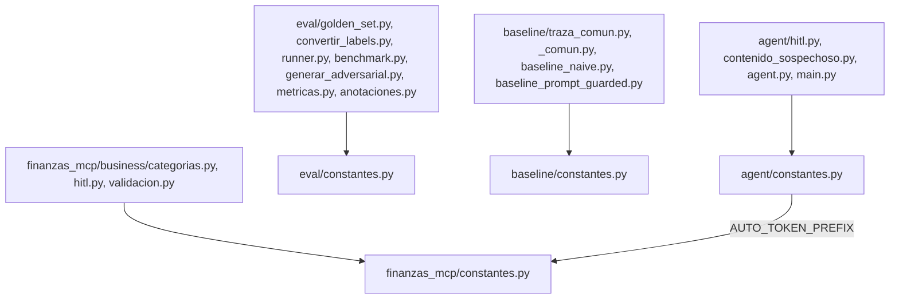

# Design Document

## Overview

Se crean cuatro módulos de constantes, uno por paquete. Cada Modulo_Origen deja de definir el literal y lo importa del archivo de su paquete, conservando el nombre antiguo como alias (`NOMBRE_ANTIGUO = NOMBRE_NUEVO` o `from ... import NOMBRE_NUEVO as NOMBRE_ANTIGUO`). Como el alias apunta al mismo objeto, no cambia ningún valor ni ningún import existente.

Lenguaje: Python 3 (el del workspace). No hay `Enum`; todo son valores de módulo.

## Architecture



Reglas de dependencia:

- `finanzas_mcp/constantes.py`: solo biblioteca estándar. No importa `mcp`.
- `agent/constantes.py`: puede importar `finanzas_mcp.constantes` (el paquete `agent` ya depende de `finanzas_mcp`). Es la única fuente de `AUTO_TOKEN_PREFIX` para `agent`, vía reexportación.
- `eval/constantes.py`: solo biblioteca estándar. `eval` no es fuente de valores de `baseline`.
- `baseline/constantes.py`: solo biblioteca estándar. No importa `finanzas_mcp`, `ocr_mcp`, `agent`, `api_pruebas`, `mcp` ni `eval` (Req. 10.10; la prueba AST de `tests/test_baselines.py` sigue vigente). Los nombres de sistema y los estados del pipeline se escriben de nuevo en este archivo. La duplicación con `eval` y `agent` es deliberada y la vigila `tests/test_constantes.py`.

## Components and Interfaces

### Inventario confirmado en el código

| Paquete | Constante (nombre nuevo) | Nombre antiguo y origen |
|---|---|---|
| finanzas_mcp | `MONEDAS_VALIDAS` (`frozenset`) | `_MONEDAS_VALIDAS`, `business/validacion.py` |
| finanzas_mcp | `CAMPOS_OBLIGATORIOS` (`tuple`) | `_CAMPOS_OBLIGATORIOS`, `business/validacion.py` (hallazgo adicional) |
| finanzas_mcp | `CATEGORIAS_CERRADAS` (`list`) | `CLOSED_CATEGORY_LIST`, `business/categorias.py` |
| finanzas_mcp | `MODOS_HITL`, `AUTO_TOKEN_PREFIX` | `business/hitl.py` |
| finanzas_mcp | `CODIGO_AUTO_NO_PERMITIDO`, `CODIGO_MONTO_ALTO`, `CODIGO_HUMANO` | `business/hitl.py` |
| agent | `ALERTAS`, `CAMPOS_REQUERIDOS`, `MAX_REGLAS`, `MAX_LONGITUD_REGLA`, `MAX_LONGITUD_RAZON`, `RAZON_SIEMPRE`, `RAZON_LIMPIA`, `PROMPT_REGISTRAR`, `PROMPT_MONTO_ALTO`, `PROMPT_DUPLICADOS`, `PROMPT_ALERTAS` | `agent/hitl.py` |
| agent | `AUTO_TOKEN_PREFIX` (reexportado de `finanzas_mcp.constantes`) | `agent/hitl.py` (hoy duplicado) |
| agent | `CATEGORIAS_CONTENIDO_SOSPECHOSO`, `MAX_CARACTERES` | `CATEGORIAS`, `MAX_CARACTERES`, `agent/contenido_sospechoso.py` |
| agent | `ESTADO_EXITO`, `ESTADO_ERROR_VALIDACION`, `ESTADO_ABORTO_USUARIO`, `ESTADO_LIMITE_PASOS`, `ESTADO_LIMITE_TOKENS`, `ESTADOS_PIPELINE` | literales en `agent/agent.py`, `agent/main.py` (`_EXIT_CODES`), docstring de `agent/tracer.py` |
| agent | `RAZON_EXITO`, `RAZON_FALLO_VALIDACION`, `RAZON_LIMITE_PASOS`, `RAZON_LIMITE_TOKENS`, `RAZON_RECHAZO_USUARIO`, `RAZONES_PIPELINE` | literales en `agent/agent.py` |
| agent | `REQUIRED_FIELDS`, `OPTIONAL_FIELDS`, `ALLOWED_FIELDS`, `OCR_REQUIRED_FIELDS` | `REQUIRED_FIELDS`, `OPTIONAL_FIELDS`, `ALLOWED_FIELDS`, `_OCR_REQUIRED`, `agent/agent.py` (hallazgo adicional) |
| eval | `DIFICULTADES`, `MINIMOS_DIFICULTAD`, `TOTAL_IMAGENES`, `TOTAL_LIMPIA`, `TOTAL_DIFICILES`, `EXTENSIONES`, `CAMPOS_GT`, `CAMPOS_DECIMALES` | `eval/golden_set.py` |
| eval | `TIPOS_CASO`, `SUBTIPOS_INTEGRIDAD`, `MINIMO_POR_SUBTIPO_INTEGRIDAD`, `VARIANTES_FECHA`, `CONDICIONES_COMPROMISO`, `MIN_VECTORES`, `MIN_IMAGENES_POR_VECTOR` | `eval/golden_set.py` |
| eval | `TRADUCCION_DIFICULTAD` | `eval/convertir_labels.py` |
| eval | `SISTEMAS` | `SISTEMAS` en `eval/runner.py` y `SISTEMAS_VALIDOS` en `eval/benchmark.py` (hoy duplicados) |
| eval | `VECTORES` | `eval/generar_adversarial.py` |
| eval | `CAMPOS_EXACTITUD`, `UMBRALES_MONTO_DEFECTO`, `PARTICIONES` | `eval/metricas.py` |
| eval | `CAMPOS_ACUERDO` | `eval/anotaciones.py` (hallazgo adicional) |
| baseline | `ESTADOS_FINALES`, `CAMPOS` | `baseline/traza_comun.py` |
| baseline | `HERRAMIENTA_INSERTAR_NOMBRE` (`insertar_transaccion`) | `baseline/_comun.py` (dos usos) |
| baseline | `SISTEMA_NAIVE`, `SISTEMA_PROMPT_GUARDED`, `SISTEMA_ARQUITECTURA` | `NOMBRE` en `baseline_naive.py` y `baseline_prompt_guarded.py`; `"arquitectura_mcp"` en `traza_comun.py` |
| baseline | `ESTADO_AGENTE_A_FINAL` (`dict`) | `_ESTADO_AGENTE`, `baseline/traza_comun.py` |

Fuera de alcance (no son listas de valores de dominio): rutas (`RAIZ`, `DIR_*`, `RUTA_*`), regex (`_RE_FECHA`), códigos de salida numéricos, `USAGE_DOCKER`, `TOOL_SERVERS`, `MCP_URL_VARS`, `_JOURNAL_MODES`, `_CLAVES_PROVEEDOR`, `PATRONES` del detector, `COMERCIOS`, `ENCABEZADOS_TABLA`, marcas del informe y los `SYSTEM_PROMPT_*` de los baselines. Se pueden mover en una iteración posterior.

### Patrón de re-exportación

```python
# finanzas_mcp/business/categorias.py
from finanzas_mcp.constantes import CATEGORIAS_CERRADAS

CLOSED_CATEGORY_LIST: list[str] = CATEGORIAS_CERRADAS  # mismo objeto
```

```python
# agent/hitl.py
from agent.constantes import ALERTAS, AUTO_TOKEN_PREFIX, CAMPOS_REQUERIDOS  # noqa: F401
```

```python
# eval/runner.py
from eval.constantes import SISTEMAS  # noqa: F401

# eval/benchmark.py
from eval.constantes import SISTEMAS as SISTEMAS_VALIDOS
```

```python
# baseline/constantes.py (sin imports de otros paquetes del proyecto)
ESTADOS_FINALES: tuple[str, ...] = ("registrada", "rechazada", "usuario_rechazo", "limite", "error")
```

### Estados del pipeline

`agent/agent.py` hoy usa literales (`"success"`, `"validation_error"`, ...). Se reemplazan por `ESTADO_*` y `RAZON_*`. Los valores no cambian, así que las trazas JSON y los códigos de salida de `agent/main.py` (`_EXIT_CODES`) quedan idénticos. El diccionario `_EXIT_CODES` pasa a usar `ESTADO_*` como claves.

### Prueba de constantes

`tests/test_constantes.py` (unittest, como el resto de la suite) contiene:

- `VALORES_ORIGINALES`: literales congelados copiados del código actual, por archivo de constantes.
- `TABLA_ALIAS: tuple[tuple[str, str, str, str], ...]`: (módulo antiguo, nombre antiguo, módulo de constantes, nombre nuevo).
- Pruebas AST para imports prohibidos, `auto:` único y type hints en funciones.
- Se omite la parte que importa `eval.generar_adversarial` si Pillow no está instalado (`unittest.skipUnless`).

## Data Models

Sin modelos nuevos. Tipos: `tuple[str, ...]`, `frozenset[str]`, `list[str]`, `dict[str, int]`, `dict[str, float]`, `dict[str, str]`, `dict[str, tuple[str, tuple[str, ...]]]` (`VECTORES`), `str`, `int`.

`CLOSED_CATEGORY_LIST` sigue siendo `list` (no `tuple`) para conservar el tipo y el objeto.

## Error Handling

- Una diferencia de valor o de identidad se detecta en `tests/test_constantes.py`, con mensaje `modulo.nombre`.
- Un import circular se evita porque los Archivos_Constantes no importan módulos de lógica del proyecto. La única arista entre paquetes es `agent.constantes -> finanzas_mcp.constantes`.
- Un import accidental prohibido en `baseline/` falla en `tests/test_baselines.py` y en `tests/test_constantes.py`.

## Correctness Properties

*A property is a characteristic or behavior that should hold true across all valid executions of a system-essentially, a formal statement about what the system should do. Properties serve as the bridge between human-readable specifications and machine-verifiable correctness guarantees.*

El dominio es finito y determinista, por eso las propiedades se implementan como pruebas parametrizadas sobre tablas (no con generadores aleatorios).

### Property 1: Valores idénticos a los originales

For any constante `c` en cualquier Archivo_Constantes, el valor de `c` es igual (`==`) y del mismo tipo que su Valor_Original congelado en la prueba.

**Validates: Requirements 2.1, 2.2, 2.3, 2.4, 2.5, 2.6, 3.1, 3.2, 3.3, 3.4, 3.5, 3.6, 3.7, 4.1, 4.2, 4.3, 4.4, 4.5, 4.6, 4.7, 4.8, 5.1, 5.2, 5.3, 5.4, 5.5, 7.1**

### Property 2: Los alias antiguos referencian el mismo objeto

For any fila (módulo, nombre antiguo, archivo de constantes, nombre nuevo) de la Tabla_Alias, `getattr(módulo, nombre_antiguo) is getattr(archivo_constantes, nombre_nuevo)`.

**Validates: Requirements 3.8, 4.9, 6.1, 6.2, 6.3**

### Property 3: Aislamiento de dependencias

For any módulo `.py` en `baseline/` (incluido `constantes.py`), ningún import absoluto apunta a `finanzas_mcp`, `ocr_mcp`, `agent`, `api_pruebas`, `mcp` ni `eval`; y For any import en `finanzas_mcp/constantes.py`, el módulo importado no es `mcp` ni empieza por `mcp.`.

**Validates: Requirements 2.7, 4.10, 5.6, 5.7, 8.3, 8.4**

### Property 4: Definición única de AUTO_TOKEN_PREFIX

For any archivo `.py` del Backend (excluidos `tests/`), el literal `"auto:"` se asigna a una constante en `finanzas_mcp/constantes.py` y en ningún otro archivo.

**Validates: Requirements 3.8, 6.4, 8.5**

### Property 5: Tipos anotados en los Archivos_Constantes

For any función definida en un Archivo_Constantes, todos sus parámetros y su retorno tienen anotación de tipo; y For any `open`/`read_text`/`write_text` en esos archivos, se indica `encoding="utf-8"`.

**Validates: Requirements 1.4, 1.5, 8.6**

## Testing Strategy

- `tests/test_constantes.py` (nuevo): Properties 1 a 5 como pruebas parametrizadas con `subTest`, más una prueba de existencia de los cuatro archivos (Req. 1.1).
- Regresión: la suite existente corre sin cambios. Cubre `labels.csv`, el manifiesto y `politica.json` de forma indirecta a través de `test_golden_set.py`, `test_generar_adversarial` y `test_politica_hitl.py`.
- Checkpoint final: `python -m pytest tests -q` desde `Backend`; línea base 234 passed, 2 skipped.
- No se usa Hypothesis aquí: no hay entradas que variar, y 100 iteraciones no encontrarían más fallos que una pasada sobre la tabla.
