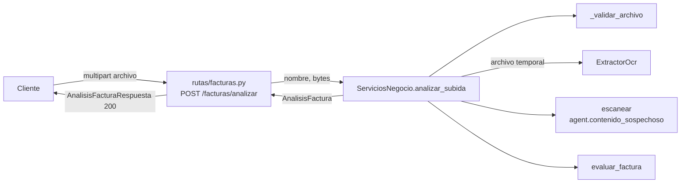

# Design Document

## Overview

Se agrega `POST /facturas/analizar` a `Backend/api_pruebas`. El endpoint recibe una imagen por multipart, ejecuta el OCR existente, aplica `evaluar_factura` y devuelve en una sola respuesta `campos`, `campos_no_identificados`, `validacion` y `advertencias`. No escribe en la base, ni trazas, ni lotes, y no deja archivos en `INVOICES_DIR`.

También se elimina `POST /validar` junto con `rutas/factura.py` y el esquema `FacturaIn`, y se crea el paquete `Backend/model` con el dataclass `Transaction`.

Decisiones de diseño:

- **Lógica en `ServiciosNegocio`.** El método nuevo `analizar_subida` vive junto a `ocr_subida`, como el resto de operaciones de negocio. La ruta solo lee el archivo y delega.
- **Archivo temporal fuera de `INVOICES_DIR`.** `ocr_subida` guarda la imagen en `INVOICES_DIR` porque luego la lee con `validar_ruta`. Para el análisis eso dejaría archivos persistentes (contradice 5.2 y 6). `analizar_subida` escribe en un archivo temporal del sistema, llama al extractor con esa ruta y lo borra en `finally`.
- **Validaciones de archivo compartidas.** Se extrae de `ocr_subida` el helper `_validar_archivo(nombre, contenido)` (extensión, firma, tamaño). `ocr_subida` conserva sus errores 415/413. `analizar_subida` captura el `ErrorApi` y lo convierte en una advertencia con HTTP 200.
- **R1 se refuerza en el Analizador.** `evaluar_factura` llama a `normalizar_defectos`, que sustituye una `fecha` ausente por la fecha de hoy. Con `fecha` en `campos_no_identificados`, R1 pasaría y `validacion.valid` sería `true`, lo que contradice 3.3. El Analizador agrega la regla R1 fallida cuando falta un Campo_Obligatorio y R1 no figura entre las reglas fallidas.
- **`validacion.reglas` lista solo reglas fallidas.** Es el comportamiento actual de `POST /validar` (`ResultadoFactura.reglas` contiene únicamente las no cumplidas). Se conserva; `valid` es `true` cuando la lista está vacía.
- **`ServiciosNegocio.validar` se conserva.** `herramientas.py` (adaptador del Pipeline) lo usa, así que no se elimina. Solo `FacturaIn` y la ruta quedan sin referencias.
- **Módulo de rutas nuevo `rutas/facturas.py`.** Sustituye a `rutas/factura.py` en `app.py`.

## Architecture



Flujo de `analizar_subida(nombre, contenido, umbral)`:

1. `_validar_archivo`. Si lanza `ErrorApi`, devuelve el análisis de fallo con el mensaje redactado en `advertencias`.
2. Escribe `contenido` en un archivo temporal con el sufijo original y llama al extractor. En `finally` borra el archivo.
3. Si el extractor lanza una excepción o `OcrResult.text` no es un JSON de objeto, devuelve el análisis de fallo con el mensaje `Fallo en la extracción OCR (<TipoExcepcion>).` redactado.
4. Reparte los Campos_Factura entre `campos` y `campos_no_identificados`.
5. Ejecuta `evaluar_factura(campos)` y aplica el refuerzo de R1.
6. Calcula las advertencias (confianza baja, contenido sospechoso).
7. Redacta mensajes y devuelve el resultado.

El análisis de fallo se calcula con el mismo camino de los pasos 4 a 6 usando `campos = {}`. Así `validacion` muestra R1 fallida con todos los campos obligatorios ausentes y las respuestas de fallo mantienen la misma forma.

## Components and Interfaces

### `api_pruebas/rutas/facturas.py` (nuevo)

```python
router = APIRouter()

@router.post(
    "/facturas/analizar",
    summary="Analizar una factura sin registrarla",
    response_model=AnalisisFacturaRespuesta,
    responses={422: {"model": ErrorEstandar, "description": "Falta la parte 'archivo'"}},
)
def analizar_factura(
    request: Request,
    archivo: UploadFile = File(..., description="Imagen o PDF de la factura"),
) -> AnalisisFacturaRespuesta:
    config = request.app.state.config
    servicios = request.app.state.servicios
    # max+1 bytes bastan para detectar el exceso sin cargar todo el archivo.
    contenido = archivo.file.read(config.max_upload_bytes + 1)
    return servicios.analizar_subida(archivo.filename or "", contenido)
```

`File(...)` obligatorio hace que una solicitud sin `archivo` falle con `RequestValidationError`, que `errores.manejar_validacion_request` ya convierte en 422 `VALIDATION_ERROR` (Requirement 5.1). La ruta no lee de disco ni escribe; el exceso de tamaño no se rechaza aquí sino en `_validar_archivo`, para responder 200 (Requirement 4.5).

### `api_pruebas/servicios.py` (cambios)

```python
CAMPOS_FACTURA = ("comercio", "fecha", "total", "moneda", "categoria",
                  "subtotal", "iva", "descripcion")
CAMPOS_OBLIGATORIOS = ("comercio", "fecha", "total", "moneda", "categoria")  # de finanzas_mcp.constantes

class ServiciosNegocio:
    def _validar_archivo(self, nombre: str, contenido: bytes) -> str:
        """Devuelve la extensión en minúsculas o lanza ErrorApi (415/415/413)."""

    def ocr_subida(self, nombre, contenido) -> tuple[Path, OcrRespuesta]:
        ext = self._validar_archivo(nombre, contenido)   # comportamiento externo sin cambios
        ...

    def analizar_subida(self, nombre: str, contenido: bytes) -> AnalisisFacturaRespuesta: ...
```

Funciones privadas de apoyo (puras, sin E/S):

```python
def _repartir_campos(payload: dict) -> tuple[dict, list[str]]:
    """campos (valor no nulo y no vacío) y campos_no_identificados, en el orden de CAMPOS_FACTURA.
    - Ignora claves fuera de CAMPOS_FACTURA.
    - Una cadena en blanco cuenta como vacía.
    - categoria pasa por _categoria_canonica; si no pertenece a CLOSED_CATEGORY_LIST
      se coloca en no identificados."""

def _reglas_validacion(campos: dict, no_identificados: list[str]) -> ValidacionRespuesta:
    """evaluar_factura(campos) + refuerzo de R1; mensajes con redactar()."""

def _advertencias(ocr: OcrResult | None, umbral: float) -> list[str]:
    """Baja confianza (si confianza < umbral) y contenido sospechoso (escanear(ocr.text).sospechoso)."""
```

Reglas de cada función:

- **Confianza.** Se usa `ocr.confianza_ocr` y, si es `None`, `ocr.confidence`. Si el valor es menor que `config.policy.umbral_confianza_ocr` (el mismo umbral del Pipeline, leído de `politica.json`), se agrega `"Confianza OCR baja (<valor> < <umbral>)."`.
- **Contenido sospechoso.** `escanear(ocr.text)` de `agent.contenido_sospechoso`, el escáner del Pipeline. Si `sospechoso` es `true` se agrega `"Se detectó contenido sospechoso en la imagen; se trató solo como dato."`. `config.py` ya importa `agent.agent`, así que el módulo `agent` ya es dependencia de `api_pruebas`.
- **Refuerzo de R1.** Si algún Campo_Obligatorio está en `campos_no_identificados` y ninguna regla R1 figura entre las fallidas, se agrega `ReglaResultado(regla="R1", valid=False, code="MISSING_FIELDS", message="Campos obligatorios ausentes o vacíos: ...")`. `valid` es `False` cuando hay alguna regla fallida.
- **Redacción.** Todo `message` de `validacion` y todo texto de `advertencias` pasa por `redactar`.

### `api_pruebas/esquemas.py` (cambios)

Se elimina `FacturaIn`. Se reutilizan `ReglaResultado` y `ValidacionRespuesta`. Se agrega:

```python
class AnalisisFacturaRespuesta(BaseModel):
    campos: dict[str, Union[str, float]] = Field(default_factory=dict)
    campos_no_identificados: list[str] = Field(default_factory=list)
    validacion: ValidacionRespuesta
    advertencias: list[str] = Field(default_factory=list)
```

### `api_pruebas/app.py` (cambios)

`from api_pruebas.rutas import batch, facturas, ocr, pipeline, transacciones, trazas` y `for modulo in (ocr, facturas, transacciones, pipeline, batch, trazas)`. Tras quitar la ruta, `POST /validar` responde 404 por el manejador `StarletteHTTPException` existente (Requirement 7.2).

### Eliminaciones (Requirement 7)

- `api_pruebas/rutas/factura.py` se borra.
- `FacturaIn` se borra de `esquemas.py` (solo lo usaba esa ruta).
- `ServiciosNegocio.validar`, `ReglaResultado` y `ValidacionRespuesta` se conservan porque `herramientas.py` y la ruta nueva los usan.
- Se buscan referencias residuales a `/validar` en `README.md`, pruebas y documentación, y se actualizan.

### `Backend/model` (nuevo)

```
Backend/model/__init__.py      # from model.transaction import Transaction
Backend/model/transaction.py
```

```python
from __future__ import annotations
from dataclasses import dataclass, asdict
from typing import Any, Mapping, Sequence

COLUMNAS = ("id", "user_id", "comercio", "fecha", "total", "moneda",
            "categoria", "subtotal", "iva", "descripcion", "created_at")

@dataclass
class Transaction:
    user_id: str
    comercio: str
    fecha: str
    total: float
    moneda: str
    categoria: str
    subtotal: float | None = None
    iva: float | None = None
    descripcion: str | None = None
    created_at: str | None = None
    id: int | None = None

    @classmethod
    def from_row(cls, row: Mapping[str, Any] | Sequence[Any]) -> "Transaction":
        """Acepta sqlite3.Row/dict (por nombre) o una tupla en el orden de COLUMNAS."""

    def to_dict(self) -> dict[str, Any]:
        """Claves = COLUMNAS."""
        return asdict(self)
```

Notas:

- El módulo solo importa `dataclasses` y `typing`. No importa `mcp` ni `finanzas_mcp` (Requirement 8.4).
- `created_at` es opcional (`None` por defecto), como pide el requisito 8.3 (el repositorio lo asigna al insertar), y los campos con valor por defecto van al final del dataclass. `from_row` y `to_dict` no dependen del orden de declaración.
- `from_row` con una fila que no tiene alguna columna obligatoria lanza `KeyError`/`ValueError` (no inventa valores).
- `Backend/model` no reemplaza al `Transaction` de `finanzas_mcp.models`, que sigue en uso. Es un modelo independiente para tipado.
- Hay que verificar que el `Dockerfile` y el `.dockerignore` incluyan `Backend/model` (si copian paquetes de forma explícita) y que `test_estructura_repositorio.py` no falle por la carpeta nueva.

## Data Models

Respuesta de ejemplo (factura con fecha no identificada):

```json
{
  "campos": {"comercio": "Auto Mercado", "total": 15200.0, "moneda": "CRC", "categoria": "Alimentación"},
  "campos_no_identificados": ["fecha", "subtotal", "iva", "descripcion"],
  "validacion": {
    "valid": false,
    "reglas": [{"regla": "R1", "valid": false, "code": "MISSING_FIELDS",
                "message": "Campos obligatorios ausentes o vacíos: fecha"}]
  },
  "advertencias": ["Confianza OCR baja (0.62 < 0.75)."]
}
```

Reglas de asignación de campos:

| Valor en la salida del OCR | Destino |
|---|---|
| clave ausente, `null`, cadena vacía o solo espacios | `campos_no_identificados` |
| `categoria` fuera de `CLOSED_CATEGORY_LIST` tras canonicalizar | `campos_no_identificados` |
| `categoria` equivalente sin acentos ni mayúsculas | `campos` con el nombre oficial |
| cualquier otro valor | `campos` |
| claves que no son Campos_Factura | se ignoran |

Los dos contenedores son una partición de los ocho Campos_Factura, en el orden de `CAMPOS_FACTURA`.

## Error Handling

| Situación | HTTP | Resultado |
|---|---|---|
| Falta la parte `archivo` | 422 | `{code: "VALIDATION_ERROR", message}` (handler existente) |
| Extensión no permitida, firma que no coincide, tamaño > `max_upload_bytes` | 200 | `campos = {}`, los 8 campos en `campos_no_identificados`, motivo redactado en `advertencias`, `validacion` con R1 fallida |
| Excepción del extractor o JSON ilegible en `OcrResult.text` | 200 | Igual que la fila anterior, con `Fallo en la extracción OCR (<Tipo>).` |
| `OcrToolError` del extractor | 200 | Igual; se usa su mensaje redactado |
| `POST /validar` | 404 | Formato de error estándar (handler existente) |

Detalles:

- Solo se expone el tipo de la excepción, como hace hoy `ocr_ruta`. Nunca el texto original, que podría contener secretos.
- El archivo temporal se elimina en `finally` aunque el extractor falle. Un fallo al borrarlo se registra en el log y no cambia la respuesta.
- El análisis no abre `TransactionRepository`, no usa `TrazaStore` ni `batch`, y no escribe en `INVOICES_DIR`.
- El archivo temporal usa `tempfile.mkstemp(suffix=ext)`; el nombre original del cliente no forma parte de la ruta, lo que evita recorridos de ruta.

## Correctness Properties

*A property is a characteristic or behavior that should hold true across all valid executions of a system-essentially, a formal statement about what the system should do. Properties serve as the bridge between human-readable specifications and machine-verifiable correctness guarantees.*

Reflexión: 1.2, 2.1, 2.2 y 2.3 se resumen en la partición de campos. 1.3, 3.1 y 4.1 se resumen en la forma de la respuesta. 4.4 y 4.5 comparten la misma forma de respuesta de fallo. 6.1, 6.2 y 6.3 se resumen en la ausencia de efectos secundarios.

### Property 1: Partición de campos

For any salida del OCR (con valores presentes, nulos, vacíos, en blanco o claves ajenas), cada Campo_Factura aparece en exactamente una de las claves `campos` o `campos_no_identificados`. `campos` contiene solo los campos con valor no nulo y no vacío, y `campos_no_identificados` contiene exactamente los restantes.

**Validates: Requirements 1.2, 2.1, 2.2, 2.3**

### Property 2: Categoría fuera de la lista cerrada

For any valor de `categoria` devuelto por el OCR, `categoria` está en `campos` si y solo si el valor coincide con una categoría de `CLOSED_CATEGORY_LIST` sin distinguir mayúsculas ni acentos, y en ese caso el valor devuelto es el nombre oficial. En cualquier otro caso está en `campos_no_identificados`.

**Validates: Requirements 2.4**

### Property 3: Forma de la respuesta de análisis

For any archivo válido, inválido o con OCR fallido, la respuesta tiene código HTTP 200 y contiene exactamente las claves `campos`, `campos_no_identificados`, `validacion` y `advertencias`. `validacion` contiene `valid` y `reglas`, y cada regla contiene `regla`, `valid`, `code` y `message`. `advertencias` es una lista de cadenas.

**Validates: Requirements 1.3, 3.1, 4.1**

### Property 4: La validación refleja a evaluar_factura

For any conjunto de campos extraídos, `validacion.valid` es `false` si y solo si `evaluar_factura(campos)` devuelve alguna regla fallida o falta algún Campo_Obligatorio, y todas las reglas fallidas de `evaluar_factura` aparecen en `validacion.reglas` con el mismo `regla` y `code`.

**Validates: Requirements 3.2**

### Property 5: Campo obligatorio faltante invalida con R1

For any salida del OCR a la que le falta al menos un Campo_Obligatorio (incluida `fecha`), `validacion.valid` es `false` y `validacion.reglas` contiene la regla R1 con `valid` igual a `false`.

**Validates: Requirements 3.3**

### Property 6: Redacción de secretos

For any salida del OCR o mensaje de error que contenga un valor de clave de API presente en el entorno, ni el cuerpo de `validacion` ni el de `advertencias` contienen ese valor.

**Validates: Requirements 3.4, 4.4, 4.5**

### Property 7: Advertencia de baja confianza

For any confianza global `c` entre 0 y 1 y umbral `u` configurado, `advertencias` contiene la advertencia de baja confianza si y solo si `c < u`.

**Validates: Requirements 4.2**

### Property 8: Advertencia de contenido sospechoso

For any texto de salida del OCR, `advertencias` contiene la advertencia de contenido sospechoso si y solo si `escanear(texto).sospechoso` es `true`.

**Validates: Requirements 4.3**

### Property 9: Respuesta de fallo uniforme

For any falla del análisis (excepción del extractor con cualquier tipo y mensaje, JSON ilegible, extensión no permitida, firma que no coincide con la extensión o tamaño mayor que `max_upload_bytes`), la respuesta tiene código HTTP 200, `campos` vacío, los ocho Campos_Factura en `campos_no_identificados` y al menos una advertencia con el motivo.

**Validates: Requirements 4.4, 4.5**

### Property 10: Sin archivos temporales residuales

For any solicitud de análisis, sea exitosa o fallida, al responder no queda ningún archivo temporal del análisis en el directorio temporal ni en `INVOICES_DIR`.

**Validates: Requirements 5.2**

### Property 11: Análisis sin efectos secundarios

For any Factura_Imagen y cualquier número de solicitudes consecutivas con ella, el conteo de filas de `transactions` y el contenido de `TRACES_DIR` y `BATCH_TRACES_DIR` son iguales antes y después, y las respuestas son iguales entre sí.

**Validates: Requirements 6.1, 6.2, 6.3**

### Property 12: Round trip fila-modelo

For any `Transaction` válida, convertirla a una fila con las columnas de `transactions`, reconstruirla con `Transaction.from_row` y llamar a `to_dict` produce un diccionario igual al de la instancia original, con las claves de las columnas.

**Validates: Requirements 8.5**

## Testing Strategy

Enfoque dual: pruebas de propiedades para las reglas de reparto, validación y ausencia de efectos, y pruebas de ejemplo para el cableado y la eliminación de `/validar`.

**Propiedades (Hypothesis, ya presente en el proyecto, mínimo 100 iteraciones).** Se usa `crear_app(config, extractor_ocr=falso)` con `TestClient`, una base SQLite temporal y un extractor falso que devuelve un `OcrResult` construido a partir de un diccionario generado (como en `tests/_dobles.py`). Cada prueba lleva la etiqueta `Feature: invoice-analyze-api, Property N: <texto>`.

- Propiedades 1, 2, 4, 5, 6: generador de salidas OCR con campos presentes, nulos, vacíos, en blanco, claves ajenas y variantes de `categoria` con acentos y mayúsculas.
- Propiedades 3, 9: generador de archivos (extensión, firma y tamaño; `max_upload_bytes` pequeño en la configuración de prueba) y de excepciones del extractor.
- Propiedad 6: se fija una clave de API en el entorno con `monkeypatch` y se inserta en `comercio` y en el mensaje de la excepción.
- Propiedades 7, 8: generador de confianza y de texto con y sin un patrón del catálogo de `contenido_sospechoso`.
- Propiedad 10: se compara el listado de `tempfile.gettempdir()` (con `tempfile.tempdir` apuntando a un directorio de prueba) e `INVOICES_DIR` antes y después.
- Propiedad 11: conteo de filas con `TransactionRepository` y snapshot de los directorios de trazas.
- Propiedad 12: generador de `Transaction`; la fila se obtiene insertando en una base SQLite en memoria con el esquema de `transactions` y leyendo con `row_factory = sqlite3.Row`.

**Pruebas de ejemplo y humo.**

- `POST /facturas/analizar` con un PNG mínimo devuelve 200 y las cuatro claves (1.1).
- Sin parte `archivo` devuelve 422 con `VALIDATION_ERROR` (5.1).
- `/openapi.json` contiene `/facturas/analizar` con el esquema `AnalisisFacturaRespuesta` (1.4) y no contiene `/validar` (7.1).
- `POST /validar` devuelve 404 con `{code, message}` (7.2).
- Las rutas `/ocr`, `/transacciones`, `/pipeline`, `/batch` y `/trazas` siguen registradas; se ejecutan las pruebas existentes (`test_api_ocr_form.py`, `test_api_pruebas_hitl.py`) (7.4).
- Búsqueda en el código: no existen `rutas/factura.py` ni `FacturaIn` (7.5).
- `model.Transaction` tiene los campos de `PRAGMA table_info(transactions)`, con la opcionalidad de 8.3 (8.2, 8.3).
- Importar `model` en un subproceso limpio no carga `mcp` ni `finanzas_mcp` en `sys.modules` (8.4).
- Las pruebas de `/ocr` siguen verdes tras extraer `_validar_archivo` (regresión).

Las pruebas nuevas se ubican en `Backend/tests/` (por ejemplo `test_api_facturas_analizar.py` y `test_model_transaction.py`).
